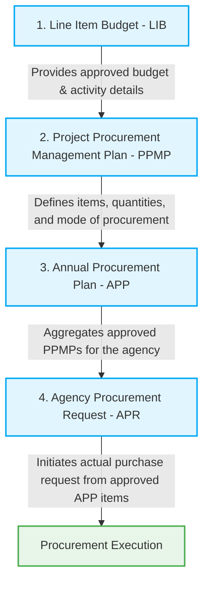
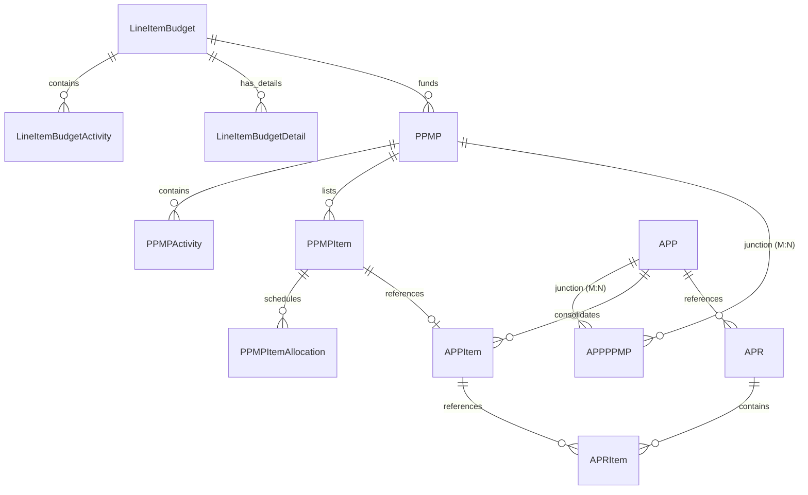

# ERPEZ Budget-to-Procurement Process Flow (LIB to APR)

This document describes the end-to-end process flow and relationship mappings from the **Line Item Budget (LIB)** to the **Agency Procurement Request (APR)**. This specification serves as a guide for understanding the system flow, database relationships, and testing the APR-related backend and frontend files.

---

## 1. Overview of the Lifecycle

The ERPEZ system bridges the gap between financial planning and actual procurement execution. The lifecycle flows sequentially through four main stages:

---

## 2. Step-by-Step Process Flow

### Step 1: Line Item Budget (LIB)
* **Purpose**: Defines the financial boundaries and activity-level or project-level budget allocations for a Delivery Unit (Office/PMO) for a specific Fiscal Year.
* **Source Types**:
  - **WFP (Work and Financial Plan)**: Requires `SourceId` referencing the master WFP.
  - **OPCR (Office Performance Commitment and Review)**: Requires `SourceId` referencing the master OPCR.
  - **Independent (Ad-hoc)**: `SourceId` is null.
* **Key Features**:
  - Contains `LineItemBudgetActivity` and `LineItemBudgetDetail` records detailing UACS object codes and monthly/quarterly allocations.
  - Supports consolidation (`IsConsolidated = true`) from child delivery units to parent delivery units.
* **Workflow Status**: Draft $\rightarrow$ Submitted $\rightarrow$ Approved. Only **Approved** LIBs can be linked to PPMPs.

### Step 2: Project Procurement Management Plan (PPMP)
* **Purpose**: A detailed plan prepared by the end-user/Office showing the items, quantities, and estimated cost of procurement required to support their approved activities.
* **Connection to LIB**:
  - Linked via `PPMP.LIBId`.
  - The sum of the `TotalEstimatedBudget` of all `PPMPItems` must not exceed the allocations specified in the approved `LineItemBudget`.
* **Key Features**:
  - Lists specific procurement items (`PPMPItem`) and schedules their procurement using monthly allocations (`PPMPItemAllocation`).
  - Supports sub-office PPMP consolidation into Department/Parent PPMPs using `ParentId` and `ConsolidatedIntoId`.
* **Workflow Status**: Draft $\rightarrow$ Submitted $\rightarrow$ Approved.

### Step 3: Annual Procurement Plan (APP)
* **Purpose**: The agency’s master plan containing all procurement activities scheduled for the fiscal year.
* **Connection to PPMP**:
  - The Planning/Procurement unit consolidates approved PPMPs into the APP using the `APPPPMP` junction table.
  - `APPItem` records are created for each selected `PPMPItem`.
  - Each `APPItem` defines the `ProcurementModeId`, `FundSourceId`, and flags for Early Procurement Activity (EPA) or Outsourcing.
* **Workflow Status**: Draft $\rightarrow$ Submitted $\rightarrow$ Approved. Only **Approved** APPs can be used as a source for APRs.

### Step 4: Agency Procurement Request (APR)
* **Purpose**: The actual request submitted by an office to purchase items from the approved APP.
* **Connection to APP**:
  - Instantiated from an approved `APP` via `CreateAPRCommand`.
  - A user selects specific `APPItem` records to include in the `APR` (resulting in `APRItem` records).
  - The quantities and unit costs default to the APP allocations but can be overridden as long as the total does not violate budget constraints.
* **Renumbering Sequence**:
  - **Draft APR**: Initial number is generated as `APR-{Year}-DRAFT-{OfficeCode}-{Seq}` (e.g., `APR-2026-DRAFT-HR-001`).
  - **Submitted/Final APR**: Upon submission, the APR number is updated to a flat, consecutive sequence for the fiscal year (e.g., `APR-2026-0001`).
* **Workflow Status**: Draft $\rightarrow$ Submitted $\rightarrow$ Approved.

---

## 3. Entity Relationships and Data Model Map

Below is a representation of the key database entities involved in the flow:

### Table Field Mappings

| Stage | Entity Header | Entity Detail / Item | Key Reference Fields |
| :--- | :--- | :--- | :--- |
| **LIB** | `LineItemBudget` | `LineItemBudgetDetail` | `LineItemBudgetId`, `SourceId`, `IsConsolidated` |
| **PPMP** | `PPMP` | `PPMPItem` | `LIBId`, `OfficeId`, `FiscalYearId`, `FundSourceId` |
| **APP** | `APP` | `APPItem` | `PPMPItemId`, `ProcurementModeId`, `FundSourceId` |
| **APR** | `APR` | `APRItem` | `APPId`, `APPItemId`, `PPMPItemId`, `OfficeId` |

---

## 4. Business Validation Rules for APR Testing

To write comprehensive tests for APR-related files, ensure that the following business rules are validated:

### 1. Source APP Validation
* **Rule**: The selected APP must exist and its status must be `Approved` (`StatusEnum.Approved`).
* **Test Case**: Attempt to create an APR referencing a Draft or Submitted APP.
* **Expected Result**: Validation fails with `InvalidOperationException` ("Selected APP is not approved.").

### 2. Item Association
* **Rule**: All selected line items in the request must belong to the referenced APP.
* **Test Case**: Pass an `APPItemId` that belongs to a different APP.
* **Expected Result**: Validation fails with `InvalidOperationException` ("One or more selected line items do not belong to the selected APP.").

### 3. Quantity & Cost Validation
* **Rule**: Every line item must have a valid quantity ($>0$) and unit cost ($>0$). If the override parameters (`QuantityRequested` / `UnitCost`) are null, they must default to the values defined in the PPMP/APP allocations.
* **Test Case**: Create an APR with an override quantity of `0` or a negative value.
* **Expected Result**: Validation fails with an error indicating invalid quantities.

### 4. Budget Ceiling Validation
* **Rule**: The total cost of the APR (`TotalAmount`) cannot exceed the total approved budget of the selected APP items (`appApprovedBudget`).
* **Test Case**: Request quantities or unit costs that make the APR total exceed the APP approved budget.
* **Expected Result**: Validation fails with `InvalidOperationException` (e.g., `"APR budget (₱X) exceeds APP approved budget (₱Y)."`).

### 5. Draft vs. Submitted Numbering Sequence
* **Rule**: 
  - On creation, the APR status is `Draft`, and its number follows the pattern `APR-{Year}-DRAFT-{OfficeCode}-{Seq}`.
  - On submission (`SubmitAPRCommand`), the status changes to `Submitted` (or goes into the approval workflow), and the number is converted to a flat sequence `APR-{Year}-{Seq}`.
* **Test Case**: 
  - Create a new APR and verify the number pattern has `-DRAFT-`.
  - Submit the same APR and verify that the number changes to a sequential number without `-DRAFT-`.

### 6. Mutually Exclusive Deletion/Modification
* **Rule**: An APR can only be updated or deleted while it is in the `Draft` status. Once submitted or approved, it is locked.
* **Test Case**: Call `UpdateAPRCommand` or `DeleteAPRCommand` on a submitted APR.
* **Expected Result**: Validation/execution fails because the status is no longer `Draft`.
