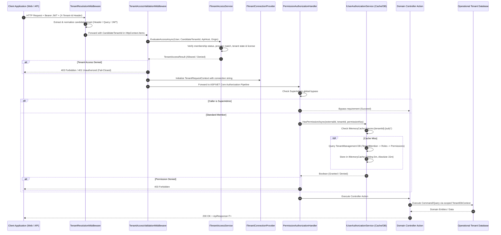
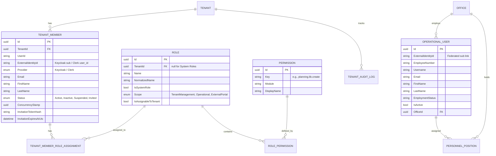
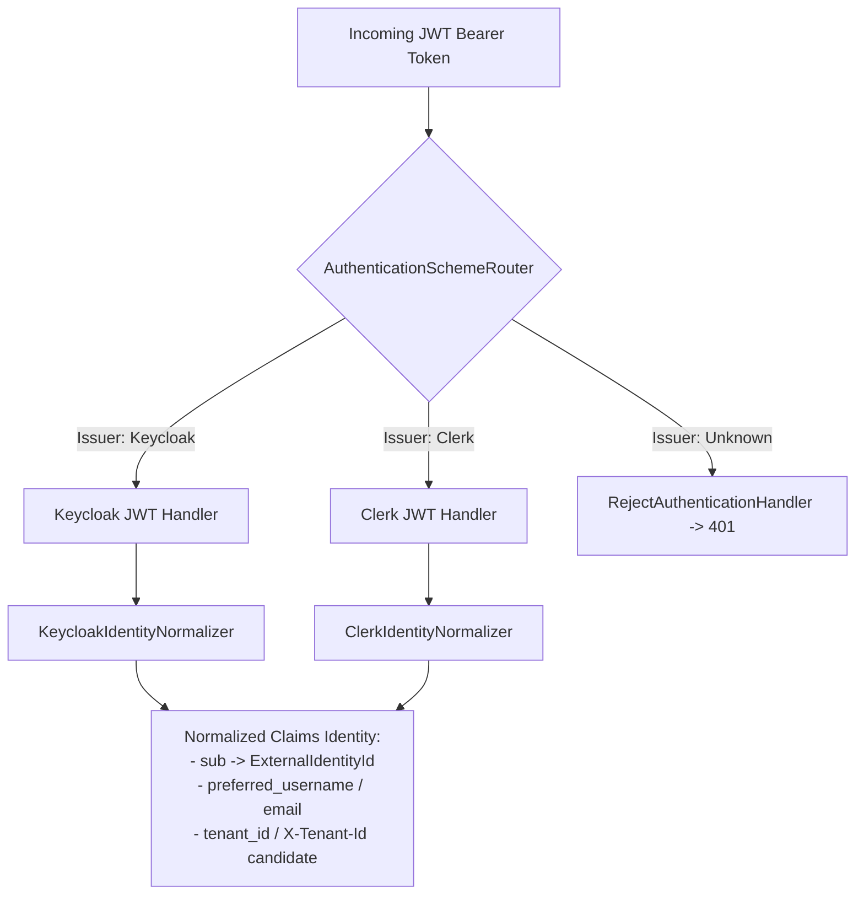
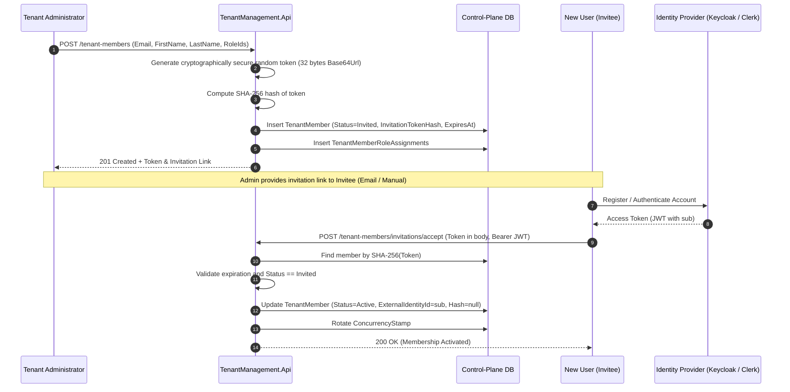
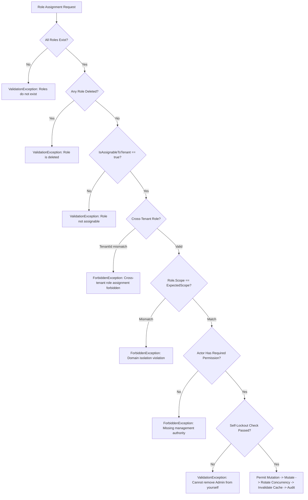

# ERPEZ Role-Based Access Control (RBAC) & User Management System Documentation

This document provides the definitive, comprehensive guide to the **Role-Based Access Control (RBAC)** architecture, **Two-Tier User Management**, security invariants, system role definitions, atomic permission catalog, backend and frontend enforcement engines, and development test personas across the **ERPEZ** platform.

---

## Table of Contents

1. [Executive Summary & Security Philosophy](#1-executive-summary--security-philosophy)
2. [End-to-End System Architecture](#2-end-to-end-system-architecture)
3. [Two-Tier User & Identity Management](#3-two-tier-user--identity-management)
   - [3.1 Control Plane: Tenant Members (`TenantMember`)](#31-control-plane-tenant-members-tenantmember)
   - [3.2 Operational Data Plane: Personnel Users (`User`)](#32-operational-data-plane-personnel-users-user)
   - [3.3 Identity Federation & Dual-IdP Architecture](#33-identity-federation--dual-idp-architecture)
   - [3.4 Tenant Member Invitation & Onboarding Lifecycle](#34-tenant-member-invitation--onboarding-lifecycle)
4. [Role Taxonomy & Domain Scopes (`RoleScope`)](#4-role-taxonomy--domain-scopes-rolescope)
5. [Pre-Seeded System Roles Reference](#5-pre-seeded-system-roles-reference)
   - [5.1 Operational ERP Roles](#51-operational-erp-roles)
   - [5.2 Tenant Governance Roles](#52-tenant-governance-roles)
   - [5.3 External Portal Roles](#53-external-portal-roles)
   - [5.4 Tenant-Custom Roles](#54-tenant-custom-roles)
6. [Canonical Atomic Permissions Reference](#6-canonical-atomic-permissions-reference)
   - [6.1 Planning Domain (`planning.*`)](#61-planning-domain-planning)
   - [6.2 Finance Domain (`finance.*`)](#62-finance-domain-finance)
   - [6.3 Procurement Domain (`procurement.*`)](#63-procurement-domain-procurement)
   - [6.4 Administration Domain (`admin.*`)](#64-administration-domain-admin)
   - [6.5 Platform Control Plane (`platform.*`)](#65-platform-control-plane-platform)
7. [Role Assignment Governance & Validation Engine](#7-role-assignment-governance--validation-engine)
   - [7.1 Validation Rules & Invariants](#71-validation-rules--invariants)
   - [7.2 Self-Lockout Prevention](#72-self-lockout-prevention)
   - [7.3 Optimistic Concurrency Control](#73-optimistic-concurrency-control)
   - [7.4 Append-Only Audit Logging](#74-append-only-audit-logging)
8. [Backend Authorization Pipeline](#8-backend-authorization-pipeline)
   - [8.1 Gatekeeper Pipeline & Tenant Context Resolution](#81-gatekeeper-pipeline--tenant-context-resolution)
   - [8.2 Dynamic Policy Synthesis & Permission Handlers](#82-dynamic-policy-synthesis--permission-handlers)
   - [8.3 In-Memory Permission Caching & Real-Time Invalidation](#83-in-memory-permission-caching--real-time-invalidation)
9. [Frontend Authorization & UI Gating](#9-frontend-authorization--ui-gating)
   - [9.1 Permissions Hook (`usePermissions`)](#91-permissions-hook-usepermissions)
   - [9.2 Route Guards (`RoutePermissionGuard`)](#92-route-guards-routepermissionguard)
   - [9.3 Inline Element Gating & Action Controls](#93-inline-element-gating--action-controls)
   - [9.4 Tenant Management User Administration UI](#94-tenant-management-user-administration-ui)
10. [REST API Specification for User & Role Management](#10-rest-api-specification-for-user--role-management)
11. [Development Personas & Testing Guide](#11-development-personas--testing-guide)
12. [Developer Implementation Guide](#12-developer-implementation-guide)

---

## 1. Executive Summary & Security Philosophy

ERPEZ employs a modern, multi-tenant, claims-based Role-Based Access Control (RBAC) and user management architecture designed for public-sector enterprise governance and resource planning.

```
┌─────────────────────────────────────────────────────────────────────────────────┐
│                           CORE SECURITY PRINCIPLES                              │
├────────────────────────────────┬────────────────────────────────────────────────┤
│ Principle                      │ Implementation                                 │
├────────────────────────────────┼────────────────────────────────────────────────┤
│ 1. Fail-Closed by Default      │ Any missing identity, unverified tenant, or    │
│                                │ unresolved permission immediately halts        │
│                                │ evaluation and yields 401 Unauthorized or      │
│                                │ 403 Forbidden.                                 │
├────────────────────────────────┼────────────────────────────────────────────────┤
│ 2. Multi-Tenant Separation     │ Control plane metadata (memberships, roles) is │
│    (Database-per-Tenant)       │ strictly partitioned from operational tenant   │
│                                │ ERP databases (personnel, budgets, plans).     │
├────────────────────────────────┼────────────────────────────────────────────────┤
│ 3. Domain Scope Isolation      │ Roles belong to explicit scopes                │
│    (`RoleScope`)               │ (`TenantManagement`, `Operational`,            │
│                                │ `ExternalPortal`). Roles cannot cross scope    │
│                                │ boundaries during assignment.                  │
├────────────────────────────────┼────────────────────────────────────────────────┤
│ 4. Privilege Delegation Guard  │ Actors cannot grant permissions they do not    │
│                                │ hold, nor remove administrator privileges      │
│                                │ from themselves (anti-lockout invariant).      │
├────────────────────────────────┼────────────────────────────────────────────────┤
│ 5. Dual-IdP Support            │ Native interoperability with Keycloak (ERP)    │
│                                │ and Clerk (SaaS), unified via standard claims  │
│                                │ normalization (`sub`, `tenant_id`).            │
├────────────────────────────────┼────────────────────────────────────────────────┤
│ 6. High-Performance Caching    │ Evaluated permissions are cached in memory     │
│    with Real-Time Invalidation │ with sliding windows and instantly evicted     │
│                                │ upon role assignment mutations.                │
└────────────────────────────────┴────────────────────────────────────────────────┘
```

---

## 2. End-to-End System Architecture

The following sequence details how an authenticated HTTP request travels through tenant resolution, access validation, dynamic permission verification, and database routing:



---

## 3. Two-Tier User & Identity Management

ERPEZ decouples **identity governance** (SaaS control plane) from **enterprise personnel** (ERP operational plane). This two-tier design guarantees that an organization's organizational chart and employment hierarchy do not compromise administrative platform governance.



### 3.1 Control Plane: Tenant Members (`TenantMember`)

The `TenantMember` entity located in `TenantManagement.Domain.Entities.TenantMember` represents a user account's authorized membership within a specific tenant organization.

* **Primary Key & Tenancy**: `Id` (GUID), `TenantId` (GUID).
* **Federated Identity Binding**: `ExternalIdentityId` stores the immutable subject identifier (`sub`) issued by Keycloak or Clerk.
* **Provider Tagging**: `Provider` (`IdentityProvider.Keycloak` or `IdentityProvider.Clerk`). Enforces the Model A security invariant: members cannot authenticate against a tenant configured for a different provider.
* **Membership Status**:
  * `Invited` (0): Membership created; awaiting token acceptance by the invitee.
  * `Active` (1): Fully authorized member eligible for role evaluation and ERP data plane access.
  * `Inactive` (2): Temporarily disabled; all operational and control plane access is rejected.
  * `Suspended` (3): Administratively blocked due to compliance or governance locks.
* **Concurrency & Invitation Security**:
  * `ConcurrencyStamp`: Rotated on every mutation to detect and reject concurrent updates (HTTP 409 Conflict).
  * `InvitationTokenHash`: SHA-256 cryptographic hash of single-use invitation tokens. Cleartext tokens are never stored in the database.
  * `InvitationExpiresAtUtc`: UTC timestamp defining token expiration (default: 7 days).

### 3.2 Operational Data Plane: Personnel Users (`User`)

The `User` entity located in `Dashboard.Domain.Entities.Planning.User` represents an employee or official within the tenant's operational database.

* **Dual Function**: Serves as both the employee personnel record and the local identity profile.
* **Core Attributes**: `EmployeeNumber`, `Username`, `Email`, `FirstName`, `MiddleName`, `LastName`, `NameExtension`, `PhoneNumber`, `EmploymentStatus` (e.g., Regular, Contractual), `DateHired`, `DateSeparated`, `IsActive`.
* **Organizational Links**: `OfficeId` links the user to their functional division or unit (`Office`).
* **Positions & Plantilla**: Linked to `PersonnelPosition` and `Position` entities for government plantilla item tracking.
* **Federation Link**: `ExternalIdentityId` links the operational employee record back to the federated IdP subject identifier.

### 3.3 Identity Federation & Dual-IdP Architecture

ERPEZ supports three operational identity modes configured via the `AUTH_PROVIDER` environment variable:



1. **`keycloak` Mode**: Designed for institutional on-premises and enterprise cloud deployments. Tokens carry `sub`, `preferred_username`, `email`, and `roles`.
2. **`clerk` Mode**: Designed for commercial SaaS self-service tenant onboarding. Tokens carry `sub`, `org_id`, and `email`.
3. **`hybrid` Mode (Default in Development)**: Dynamically inspects the `iss` (issuer) claim of the JWT. Valid Keycloak tokens route to the Keycloak validation handler; valid Clerk tokens route to the Clerk validation handler. Unknown issuers route to `RejectAuthenticationHandler`, preventing spoofing attacks.

### 3.4 Tenant Member Invitation & Onboarding Lifecycle



---

## 4. Role Taxonomy & Domain Scopes (`RoleScope`)

To enforce strict domain boundaries, every role in ERPEZ is tagged with an architectural scope (`RoleScope` enum located in `TenantManagement.Domain.Enums.RoleScope`):

```csharp
public enum RoleScope
{
    Unknown = 0,          // Fail-closed safety net; cannot be assigned
    TenantManagement = 1, // Account governance, billing, subscription, member invites
    Operational = 2,      // ERP operations: Planning, Finance, Procurement, Approvals
    ExternalPortal = 3    // External third parties: Bidders, Suppliers, Contractors
}
```

### Domain Separation Invariants

1. **Endpoint Boundary**:
   * Management of `TenantManagement` roles is restricted to `/tenant-members` and `/roles` (protected by `admin.membersManage` and `admin.rolesManage`).
   * Management of `Operational` roles is restricted to `/operational-roles/assignments` (protected by `admin.operational_roles.manage`).
   * Management of `ExternalPortal` roles is restricted to Supplier Portal endpoints (protected by `procurement.supplier.manage`).
2. **Cross-Scope Assignment Prohibition**: Attempting to assign an `Operational` role via a `TenantManagement` endpoint (or vice-versa) triggers a `403 Forbidden` (`Domain isolation violation`).
3. **Fail-Closed Safety**: Any role with `RoleScope.Unknown` (value 0) cannot be assigned under any condition.

---

## 5. Pre-Seeded System Roles Reference

Configured and maintained by `RoleSeeder.cs`, these roles are system-defined (`IsSystemRole = true`, `TenantId = null`) and universally available across all tenants within their respective scopes.

### 5.1 Operational ERP Roles

| Role Name | Scope | Target User / Responsibility | Key Assigned Permissions |
| :--- | :--- | :--- | :--- |
| **`End User`** | `Operational` | Department heads, division chiefs, focal persons. Drafts and submits planning and procurement proposals. | `planning.lib.{create,update,view,submit,amend}`, `planning.wfp.{create,update,view,submit}`, `planning.opcr.{create,update,view,submit}`, `procurement.ppmp.{create,update,view,submit}`, `planning.market_scoping.*`, `planning.dashboard.view_office`, `finance.uacs.view`, `admin.org_structure.view` |
| **`Planning Officer`** | `Operational` | Corporate Planning Division, Quality Assurance. Manages KPI libraries, target assignments, PMT evaluations, and budget calls. | `planning.kpi.*`, `planning.target.manage`, `planning.rating_scale.manage`, `planning.fiscal_year.*`, `planning.budget_call.*`, `planning.workflow_matrix.manage`, `planning.economic_indicators.manage`, `planning.data_migrations.manage`, `planning.spms_function_weights.manage`, `planning.opcr.evaluate`, `planning.dashboard.view_global`, `planning.lib.view`, `planning.wfp.view` |
| **`Finance Officer`** | `Operational` | Budget Office, Accounting Division. Manages agency master budgets, office budget ceilings, fund sources, and fiscal locks. | `finance.agency_master_budget.manage`, `finance.budget_ceiling.assign`, `finance.sub_office_ceiling.assign`, `finance.fiscal_month.lock_unlock`, `finance.uacs.*`, `finance.fund_source.manage`, `planning.fiscal_year.*`, `planning.dashboard.view_global` |
| **`Procurement Officer`**| `Operational` | BAC Secretariat, Procurement Management Unit. Consolidates PPMPs into the APP, manages RFQs, BAC bidding, AOB, POs, and suppliers. | `procurement.ppmp.{view,review,consolidate}`, `procurement.app.manage`, `procurement.pr.*`, `procurement.rfq.manage`, `procurement.bac.manage`, `procurement.aob.manage`, `procurement.po.manage`, `procurement.procurement_library.*`, `procurement.procurement_thresholds.manage`, `procurement.bidding_documents.*`, `procurement.supplier.*` |
| **`LIB Approver`** | `Operational` | Designated executive reviewer for Line Item Budgets. | `planning.lib.approve`, `planning.lib.view` |
| **`WFP Approver`** | `Operational` | Designated executive reviewer for Work & Financial Plans. | `planning.wfp.approve`, `planning.wfp.view` |
| **`OPCR Approver`** | `Operational` | Performance Management Team (PMT) chair / Head of Agency. | `planning.opcr.approve`, `planning.opcr.view` |
| **`PPMP Approver`** | `Operational` | Head of Procuring Entity (HoPE) / BAC Chairperson. | `procurement.ppmp.approve`, `procurement.ppmp.view`, `planning.market_scoping.view` |
| **`Dashboard System Admin`**| `Operational` | In-tenant operational administrator managing delivery units, positions, and operational role assignments. | `admin.operational_roles.view`, `admin.operational_roles.manage`, `admin.org_structure.*`, `admin.users.manage`, `planning.fiscal_year.*`, `planning.budget_call.*`, `planning.workflow_matrix.manage`, `planning.dashboard.view_global` |

### 5.2 Tenant Governance Roles

| Role Name | Scope | Target User / Responsibility | Key Assigned Permissions |
| :--- | :--- | :--- | :--- |
| **`Tenant Administrator`** | `TenantManagement` | IT Administrators and Chief Information Officers. Full institutional authority across governance, settings, and ERP operational configurations. | Full administrative access across `admin.*`, `planning.fiscal_year.manage`, `finance.agency_master_budget.manage`, `finance.uacs.manage`, `procurement.procurement_library.manage`, and system audit logs. |
| **`Billing Administrator`**| `TenantManagement` | Financial controller managing subscription tier, invoices, receipts, and payment methods. | `admin.tenants.manage`, `admin.system_admin.view`, `admin.org_structure.view` |
| **`Tenant Auditor`** | `TenantManagement` | Compliance officers and internal auditors. Read-only access to organizational structure and audit logs. | `admin.org_structure.view`, `admin.system_admin.view` |
| **`Tenant Member`** | `TenantManagement` | Baseline tenant membership. Allows sign-in and viewing organizational hierarchy. | `admin.org_structure.view` |

### 5.3 External Portal Roles

| Role Name | Scope | Target User / Responsibility | Key Assigned Permissions |
| :--- | :--- | :--- | :--- |
| **`Supplier`** | `ExternalPortal` | External vendors and contractors participating in bidding, RFQ canvassing, and quotation submissions. | `procurement.supplier.view` |

### 5.4 Tenant-Custom Roles

Tenants can create customized roles via `POST /roles`. Custom roles have:
* `TenantId = active_tenant_guid` (strictly isolated to that tenant; invisible to all other tenants).
* `IsSystemRole = false` (can be modified or soft-deleted by the tenant administrator).
* Customizable permission sets chosen from the tenant's active module licenses.

---

## 6. Canonical Atomic Permissions Reference

All atomic permissions are string constants defined in `ERPEZ.Shared.Constants.Permissions` (Backend) and mirrored in `apps/dashboard/src/constants/permissions.ts` (Frontend).

### 6.1 Planning Domain (`planning.*`)

```
planning.dashboard.view_global            View institutional global planning dashboard & executive KPIs
planning.dashboard.view_office            View office/department-specific planning dashboard
planning.lib.create                       Draft and initialize new Line Item Budget (LIB)
planning.lib.view                         View Line Item Budgets, activities, and allocations
planning.lib.update                       Edit Line Item Budget items, amounts, and activity links
planning.lib.delete                       Delete draft Line Item Budget
planning.lib.submit                       Submit Line Item Budget for review/approval
planning.lib.approve                      Approve or return Line Item Budget
planning.lib.amend                        Request and submit Line Item Budget amendments
planning.wfp.create                       Draft and create Work & Financial Plan (WFP)
planning.wfp.view                         View Work & Financial Plans and objective breakdowns
planning.wfp.update                       Edit WFP objectives, activities, and quarterly targets
planning.wfp.delete                       Delete draft Work & Financial Plan
planning.wfp.submit                       Submit Work & Financial Plan for review
planning.wfp.approve                      Approve or return Work & Financial Plan
planning.opcr.create                      Create Office Performance Commitment & Review (OPCR)
planning.opcr.view                        View OPCR documents and target commitments
planning.opcr.update                      Edit OPCR commitments, indicators, and success measures
planning.opcr.delete                      Delete draft OPCR
planning.opcr.submit                      Submit OPCR commitment/rating for review
planning.opcr.approve                     Final approval of OPCR commitments
planning.opcr.evaluate                    PMT rating calibration and accomplishment scoring
planning.kpi.create                       Define master KPIs in the KPI Library
planning.kpi.view                         View KPI Library and active annual KPIs
planning.kpi.update                       Edit KPI measurement formulas, variables, and definitions
planning.kpi.delete                       Delete master KPI definitions
planning.kpi.assign                       Assign KPIs and targets to Delivery Units / Offices
planning.target.manage                    Configure performance targets and benchmark thresholds
planning.rating_scale.manage              Configure SPMS rating scales and templates
planning.fiscal_year.view                 View fiscal years, calendar periods, and active years
planning.fiscal_year.manage               Create, activate, lock, unlock, and rollover fiscal years
planning.budget_call.view                 View budget call milestones and schedules
planning.budget_call.manage               Create and configure budget call guidelines & deadlines
planning.workflow_matrix.manage           Configure step-by-step approval routing matrices
planning.economic_indicators.manage       Configure inflation rates, currency, and economic indices
planning.data_migrations.manage           Perform historical data imports and schema migrations
planning.spms_function_weights.manage     Configure SPMS functional weights (Strategic, Core, Support)
planning.market_scoping.view              View Market Scoping studies and price surveys
planning.market_scoping.manage            Create and edit Market Scoping studies
planning.market_scoping.submit            Submit Market Scoping studies for review
planning.market_scoping.approve           Approve Market Scoping studies
```

### 6.2 Finance Domain (`finance.*`)

```
finance.agency_master_budget.manage       Configure and manage top-level Agency Master Budgets (AMB)
finance.budget_ceiling.assign             Assign budget ceilings to offices / delivery units
finance.sub_office_ceiling.assign         Assign sub-office / department budget ceilings
finance.fiscal_month.lock_unlock          Lock and unlock accounting/fiscal months
finance.uacs.view                         View UACS chart of accounts, fund sources, and ceilings
finance.uacs.manage                       Manage UACS code segments and object combinations
finance.fund_source.manage                Create, update, and manage agency fund sources
```

### 6.3 Procurement Domain (`procurement.*`)

```
procurement.ppmp.create                   Create department Project Procurement Management Plan (PPMP)
procurement.ppmp.view                     View PPMP documents, activities, and allocations
procurement.ppmp.update                   Edit PPMP items, estimated prices, schedule, or delete draft
procurement.ppmp.submit                   Submit PPMP for department approval
procurement.ppmp.approve                  Approve or return department PPMPs
procurement.ppmp.consolidate              Consolidate approved department PPMPs into the APP
procurement.ppmp.review                   Review PPMP compliance and review audit trails
procurement.app.manage                    Manage Annual Procurement Plan (APP) and line items
procurement.pr.create                     Create Purchase Request (PR) and Agency Procurement Request (APR)
procurement.pr.manage                     Approve, update status, and consolidate PRs/APRs
procurement.rfq.manage                    Manage Request for Quotation (RFQ), supplier invites & canvass
procurement.bac.manage                    Manage Bids & Awards Committee (BAC) projects and calendar
procurement.aob.manage                    Abstract of Bids (AOB), bid matrix evaluation, and awards
procurement.po.manage                     Generate and manage Purchase Orders and Notice to Proceed (NTP)
procurement.procurement_library.view      View Procurement Item Catalog, categories, and price standards
procurement.procurement_library.manage    Add, update, and manage catalog items and price indices
procurement.procurement_thresholds.manage Configure procurement mode thresholds (SVP, Bidding, Direct)
procurement.bidding_documents.view        View standard Bidding Document Templates
procurement.bidding_documents.manage      Create and customize Bidding Document templates & clauses
procurement.supplier.view                 View registered supplier directory and quotations
procurement.supplier.manage               Accredit, blacklist, rate, and manage supplier profiles
```

### 6.4 Administration Domain (`admin.*`)

```
admin.tenants.manage                      Provision, configure, and manage tenant organizations
admin.members.manage                      Manage tenant user memberships and invitations
admin.roles.manage                        Create, customize, and assign functional roles
admin.users.manage                        Manage user profiles, employee records, and statuses
admin.org_structure.view                  View organizational hierarchy, offices, and delivery units
admin.org_structure.manage                Configure offices, divisions, sections, and positions
admin.system_admin.view                   View system health, runtime parameters, and audit logs
admin.system_admin.manage                 Configure global system parameters and subscriptions
admin.operational_roles.view              View operational roles assignable within the active workspace
admin.operational_roles.manage            Assign and unassign operational business roles to members
```

### 6.5 Platform Control Plane (`platform.*`)

```
platform.pricing.view                     View global subscription tiers and pricing models
platform.pricing.manage                   Modify commercial subscription plans and features
platform.subscribers.view                 View cross-tenant subscriber fleet metrics
platform.fleet.manage                     Execute fleet-wide maintenance and database upgrades
platform.database_silos.manage            Manage operational PostgreSQL database clusters & silos
```

---

## 7. Role Assignment Governance & Validation Engine

Role mutations are safeguarded by `RoleAssignmentValidator` (`ERPEZ.TenantManagement.Infrastructure.Services.RoleAssignmentValidator`), ensuring no actor can bypass security boundaries.

### 7.1 Validation Rules & Invariants



1. **Universal Assignability**: `r.IsAssignableToTenant && !r.IsDeleted`. Non-assignable internal roles are denied.
2. **Cross-Tenant Boundary**: If a role has `TenantId != null`, it MUST match the request's active tenant ID (`r.TenantId == tenantId`). A tenant cannot assign custom roles belonging to another organization.
3. **Domain Scope Guard**: Roles must match the endpoint's declared `expectedScope`:
   * Assigning `RoleScope.TenantManagement` roles requires `Permissions.Admin.membersManage`.
   * Assigning `RoleScope.Operational` roles requires `Permissions.Admin.operationalRolesManage`.
   * Assigning `RoleScope.ExternalPortal` roles requires `Permissions.Procurement.supplierManage`.
4. **Scope Preservation During Operational Assignment**: When updating operational roles via `AssignOperationalRolesCommandHandler`, existing `TenantManagement` roles (such as `Tenant Administrator` or `Billing Administrator`) are untouched and preserved.

### 7.2 Self-Lockout Prevention

To prevent administrative lockout:
* An actor **cannot deactivate or suspend** their own tenant membership (`Status.Inactive` or `Status.Suspended`).
* An actor holding the `Tenant Administrator` role **cannot remove** that role from their own account.

### 7.3 Optimistic Concurrency Control

`TenantMember.ConcurrencyStamp` (GUID) protects member records from race conditions. When updating member status or role assignments, the client must supply the member's current `concurrencyStamp`. If the stamp in the database has rotated due to an intervening update, the request is aborted with `409 Conflict`.

### 7.4 Append-Only Audit Logging

All member and role modifications generate immutable audit logs in `TenantAuditLog` via `ITenantAuditService`:
* Captured data: `TenantId`, `ActorExternalIdentityId`, `ActorEmail`, `TargetMemberId`, `TargetEmail`, `Action` (e.g., `OPERATIONAL_ROLES_ASSIGNED`, `MEMBER_INVITED`, `STATUS_TOGGLED`), `BeforeStateJson`, `AfterStateJson`, `CreatedAt`.
* **Database Invariant**: The EF Core DbContext configures `TenantAuditLog` as strictly append-only; update and delete operations on audit records are blocked at the persistence level.

---

## 8. Backend Authorization Pipeline

### 8.1 Gatekeeper Pipeline & Tenant Context Resolution

```
1. HTTP Request arrives
   │
2. Authentication Middleware
   │  - Evaluates Bearer JWT via Dual-IdP Router (Keycloak / Clerk)
   │  - Extracts ClaimsPrincipal (sub / NameIdentifier)
   │
3. TenantResolutionMiddleware
   │  - Extracts candidate tenant ID from:
   │      a) "X-Tenant-Id" HTTP header (primary workspace selector)
   │      b) "?tenantId=" query parameter
   │      c) "tenant_id" claim in JWT (informational fallback)
   │  - Validates for selector conflicts (header vs query vs token org)
   │  - Writes CandidateTenantId into HttpContext.Items
   │
4. TenantAccessValidationMiddleware
   │  - Authoritative gatekeeper executing ITenantAccessService.EvaluateAccessAsync
   │  - Invariant Checks:
   │      a) User is authenticated
   │      b) API host is authorized (IApiHostValidator)
   │      c) Caller is an Active, non-deleted TenantMember in this tenant
   │      d) IdentityProvider matches Tenant.AuthProvider (Model A)
   │      e) Tenant is not disabled and ProvisioningState == Ready
   │      f) Client Origin matches TenantSetting.AllowedDomain (IClientOriginMatcher)
   │  - Resolves operational DB connection string via ITenantConnectionResolver
   │  - Initializes scoped ITenantRequestContext
   │
5. Controller & Dynamic Authorization Handler
   │  - Enforces [Authorize] and [HasPermission(...)]
```

### 8.2 Dynamic Policy Synthesis & Permission Handlers

Instead of pre-configuring hundreds of static ASP.NET Core policies, ERPEZ synthesizes policies dynamically:

1. **`[HasPermission(permissionKey)]`**: Attribute decorating controller actions (e.g. `[HasPermission(Permissions.Planning.libCreate)]`).
2. **`DynamicAuthorizationPolicyProvider`**: When ASP.NET Core requests a policy matching a permission key, the provider synthesizes an `AuthorizationPolicy` on the fly containing a `PermissionRequirement(permissionKey)`.
3. **`PermissionAuthorizationHandler`**:
   * Extracts `externalIdentityId` from `ClaimTypes.NameIdentifier` or `sub`.
   * **SuperAdmin Bypass Check**: Checks for claim `is_super_admin == "true"` or role `SuperAdmin`. If true, succeeds immediately.
   * Resolves active tenant from `ITenantContextService`. If null, fails closed.
   * Calls `IUserAuthorizationService.HasPermissionAsync(externalIdentityId, tenantId, permissionKey)`.
   * If true, calls `context.Succeed(requirement)`. Otherwise, fails closed.

### 8.3 In-Memory Permission Caching & Real-Time Invalidation

`UserAuthorizationService` optimizes database performance by caching evaluated permissions in `IMemoryCache`:

* **Cache Key**: `perms:{tenantId}:{externalIdentityId}`
* **Cache Value**: `HashSet<string>` (case-insensitive set of granted atomic permission keys)
* **Expiration Policy**:
  * **Sliding Expiration**: 5 minutes
  * **Absolute Expiration**: 15 minutes
* **Real-Time Invalidation**:
  * Whenever a member's roles are updated or operational roles are assigned (`AssignOperationalRolesCommandHandler`), the service calls `InvalidateUserPermissions(targetExternalId, tenantId)`.
  * The local node's cache key is immediately evicted, ensuring that permission changes take effect on the user's very next HTTP request without requiring token re-issuance.

---

## 9. Frontend Authorization & UI Gating

### 9.1 Permissions Hook (`usePermissions`)

The `usePermissions()` hook (`apps/dashboard/src/hooks/usePermissions.ts`) provides reactive permission checking across the React UI:

```tsx
import { usePermissions } from '@/hooks/usePermissions'

export function MyComponent() {
  const { hasPermission, hasAnyPermission, isSuperAdmin, isLoaded } = usePermissions()

  if (!isLoaded) return <Skeleton />

  return (
    <div>
      {hasPermission('planning.lib.create') && (
        <Button onClick={handleCreate}>New Budget</Button>
      )}
    </div>
  )
}
```

* Queries `GET /auth/me/permissions` via `@tanstack/react-query` (`staleTime: 60s`).
* Query cache key: `['my-permissions', userName, tenantId, activeDevUser]`.
* Strict fail-closed semantics: `hasPermission` returns `false` if permissions are loading, in an error state, or if the tenant context is unresolved.

### 9.2 Route Guards (`RoutePermissionGuard`)

The `<RoutePermissionGuard>` component wraps TanStack Router route definitions:

```tsx
import { createFileRoute } from '@tanstack/react-router'
import { RoutePermissionGuard } from '@/components/RoutePermissionGuard'
import { PERMISSIONS } from '@/constants/permissions'
import { LineItemBudgetPage } from '@/features/planning/pages/LineItemBudgetPage'

export const Route = createFileRoute('/v2/planning/lib')({
  component: () => (
    <RoutePermissionGuard
      permission={PERMISSIONS.Planning.Lib.View}
      message="You do not have permission to view Line Item Budgets."
    >
      <LineItemBudgetPage />
    </RoutePermissionGuard>
  ),
})
```

* **Zero-Flicker Resolution**: Renders `null` while authentication or permissions are resolving to prevent unauthorized content flashes.
* **SuperAdmin Bypass**: Automatically renders children for SuperAdmin users.
* **Access Denied View**: Displays a clean fallback with `ShieldAlert` icon and descriptive messaging when unauthorized.

### 9.3 Inline Element Gating & Action Controls

For buttons, action menus, and workflow steps:

```tsx
import { PermissionCheck } from '@/components/PermissionCheck'
import { PERMISSIONS } from '@/constants/permissions'

// Conditionally render button
<PermissionCheck permission={PERMISSIONS.Procurement.Ppmp.Approve}>
  <Button onClick={approvePpmp}>Approve PPMP</Button>
</PermissionCheck>

// Or disable button with tooltip
<Button 
  disabled={!hasPermission(PERMISSIONS.Planning.Lib.Submit)}
  onClick={submitLib}
>
  Submit for Review
</Button>
```

### 9.4 Tenant Management User Administration UI

The Tenant Management app (`apps/tenant-management/app/pages/protected/TenantMemberPage.tsx`) provides complete user administration:
* **Member Directory**: Paginated table displaying member name, email, federated user ID, active roles, and status badges.
* **Invitation Modal**: Generates new invitations and displays the single-use invite token with one-click clipboard copying.
* **Role Assignment Modal**: Assigns governance roles (`RoleScope.TenantManagement`) fetched dynamically from `/tenant-members/assignable-roles`.
* **Status Toggle & Revocation**: Enables activating, deactivating, or revoking pending invitations with immediate toast confirmation.

---

## 10. REST API Specification for User & Role Management

### 10.1 Control Plane (`TenantManagement.Api`)

| HTTP Method | Route | Description | Required Permission |
| :--- | :--- | :--- | :--- |
| `GET` | `/tenant-members` | List paginated tenant members (supports Sieve filtering & sorting). | `admin.members.manage` |
| `POST` | `/tenant-members` | Invite new member with email, name, and initial roles. Returns single-use token. | `admin.members.manage` |
| `GET` | `/tenant-members/{id}` | Get detailed member information and assigned roles. | `admin.members.manage` |
| `PUT` | `/tenant-members/{id}` | Update member profile and governance roles. | `admin.members.manage` |
| `PATCH` | `/tenant-members/{id}/status` | Activate, deactivate, or suspend member status (requires concurrency stamp). | `admin.members.manage` |
| `POST` | `/tenant-members/{id}/invitation/revoke` | Revoke a pending invitation. | `admin.members.manage` |
| `POST` | `/tenant-members/invitations/accept` | Accept pending invitation using token. Binds caller's external `sub`. | `[Authorize]` |
| `DELETE`| `/tenant-members/{id}` | Soft-delete a tenant member. | `admin.members.manage` |
| `GET` | `/tenant-members/assignable-roles` | Get assignable governance roles (`RoleScope.TenantManagement`). | `admin.members.manage` |
| `GET` | `/operational-roles/assignable` | Get assignable ERP operational roles (`RoleScope.Operational`). | `admin.operational_roles.view` |
| `POST` | `/operational-roles/assignments` | Assign operational roles to a member (`{ targetTenantMemberId, roleIds }`). | `admin.operational_roles.manage` |
| `GET` | `/roles/assignable` | Get assignable roles for governance assignment controls. | `admin.members.manage` |
| `POST` | `/roles` | Create a tenant-custom role with specified permissions. | `admin.roles.manage` |
| `PUT` | `/roles/{id}` | Update a tenant-custom role's details and permissions. | `admin.roles.manage` |
| `DELETE`| `/roles/{id}` | Soft-delete a tenant-custom role (system roles cannot be deleted). | `admin.roles.manage` |
| `GET` | `/api/tenant/context` | Get active tenant context, features, and user membership details. | `[Authorize]` |
| `GET` | `/api/tenant/available` | List all active tenants where the caller holds active membership. | `[Authorize]` |

### 10.2 Operational Data Plane (`Dashboard.Api`)

| HTTP Method | Route | Description | Required Permission |
| :--- | :--- | :--- | :--- |
| `GET` | `/users` | List operational employee/personnel records. | `admin.users.manage` |
| `POST` | `/users` | Create new personnel record with employee number, office, and position. | `admin.users.manage` |
| `GET` | `/users/{id}` | Get personnel record details by ID. | `admin.users.manage` |
| `PUT` | `/users/{id}` | Update personnel information, contact info, and status. | `admin.users.manage` |
| `DELETE`| `/users/{id}` | Soft-delete a personnel record. | `admin.users.manage` |
| `GET` | `/operational-roles/assignable` | Get assignable operational business roles (`RoleScope.Operational`). | `admin.operational_roles.view` |
| `POST` | `/operational-roles/assignments` | Assign operational roles to a member (`{ targetTenantMemberId, roleIds }`). | `admin.operational_roles.manage` |
| `GET` | `/auth/me/permissions` | Get set of active permission keys granted to current user in active tenant. | `[Authorize]` |
| `GET` | `/auth/dev/users` | List pre-seeded development personas (Development environment only). | `[AllowAnonymous]` |
| `POST` | `/auth/dev/login` | Generate signed development JWT for persona testing. | `[AllowAnonymous]` |

---

## 11. Development Personas & Testing Guide

For local development and automated testing, `DevTenantAndMemberSeeder.cs` pre-provisions test personas bound to the default development tenant (`DevTenantId = a1b2c3d4-e5f6-7a8b-9c0d-1e2f3a4b5c6d`):

| Persona User ID | Display Name | Email | Roles Assigned | Primary Testing Use Case |
| :--- | :--- | :--- | :--- | :--- |
| **`dev_superadmin`** | Super Administrator | `superadmin@erpez.dev` | Tenant Administrator *(SuperAdmin)* | Global bypass testing; multi-tenant administration. |
| **`dev_planner`** | Planning Officer | `planner@erpez.dev` | Planning Officer | KPI calibration, SPMS weighting, fiscal year lifecycle. |
| **`dev_preparer`** | End User / Preparer | `preparer@erpez.dev` | End User | Drafting LIB, WFP, OPCR, and PPMP documents. |
| **`dev_approver`** | Approver | `approver@erpez.dev` | LIB Approver, PPMP Approver, WFP Approver, OPCR Approver | Workflow review, document approval, and returning drafts. |
| **`dev_finance`** | Finance Officer | `finance@erpez.dev` | Finance Officer | Agency master budgets, UACS accounts, fund source ceilings. |
| **`dev_procurement`**| Procurement Officer | `procurement@erpez.dev`| Procurement Officer | PPMP consolidation into APP, PR, BAC, RFQ, PO generation. |
| **`dev_admin`** | Tenant Admin | `admin@erpez.dev` | Tenant Administrator | Organization structure, user onboarding, role assignments. |
| **`dev_supplier`** | Supplier / Vendor | `supplier@erpez.dev` | Supplier | Supplier portal bidding, canvass quotations, RFQ responses. |

### Development Persona Switching Workflow

1. **Via UI**: In the dashboard, use the floating **`DevRoleSwitcher`** widget in the bottom-left corner to switch personas in one click. The widget automatically requests a new dev JWT, resets QueryClient caches, and updates the UI state.
2. **Via API**: Call `POST /auth/dev/login` to obtain a signed bearer JWT:

```bash
# Obtain dev JWT for Planning Officer
curl -X POST http://localhost:5000/auth/dev/login \
  -H "Content-Type: application/json" \
  -d '{"username": "dev_planner"}'
```

---

## 12. Developer Implementation Guide

### 12.1 Adding a New Atomic Permission

1. **Add Backend Constant**: Open [Permissions.cs](file:///c:/Users/almau/ERPEZ-backend/apps/backend/Shared/Constants/Permissions.cs) and add the key to the appropriate domain class and the `GetAllPermissions()` list:
   ```csharp
   public static class Planning
   {
       public const string newFeatureManage = "planning.new_feature.manage";
   }
   ```
2. **Add Frontend Constant**: Open [permissions.ts](file:///c:/Users/almau/ERPEZ-backend/apps/dashboard/src/constants/permissions.ts) and add the matching key:
   ```typescript
   Planning: {
     NewFeature: {
       Manage: 'planning.new_feature.manage',
     },
   }
   ```
3. **Seed in Roles**: Update [RoleSeeder.cs](file:///c:/Users/almau/ERPEZ-backend/apps/backend/TenantManagement/TenantManagement.Infrastructure/Persistence/Repositories/RoleSeeder.cs) to assign the permission to relevant system roles.

### 12.2 Securing a Backend Controller Action

Always apply `[Authorize]` at the class level and `[HasPermission]` at the method level:

```csharp
using ERPEZ.Shared.Authorization;
using ERPEZ.Shared.Constants;
using Microsoft.AspNetCore.Authorization;
using Microsoft.AspNetCore.Mvc;

namespace ERPEZ.Api.Controllers;

[ApiController]
[Route("api/my-feature")]
[Authorize]
public class MyFeatureController : ControllerBase
{
    [HttpGet]
    [HasPermission(Permissions.Planning.libView)]
    public async Task<IActionResult> GetItems() => Ok();

    [HttpPost]
    [HasPermission(Permissions.Planning.newFeatureManage)]
    public async Task<IActionResult> CreateItem([FromBody] CreateItemDto dto) => Ok();
}
```

### 12.3 Protecting a Frontend Route & Component

```tsx
import { createFileRoute } from '@tanstack/react-router'
import { RoutePermissionGuard } from '@/components/RoutePermissionGuard'
import { PERMISSIONS } from '@/constants/permissions'
import { MyFeaturePage } from '@/features/my-feature/pages/MyFeaturePage'

export const Route = createFileRoute('/v2/my-feature')({
  component: () => (
    <RoutePermissionGuard
      permission={PERMISSIONS.Planning.NewFeature.Manage}
      message="You do not have permission to manage this feature."
    >
      <MyFeaturePage />
    </RoutePermissionGuard>
  ),
})
```
