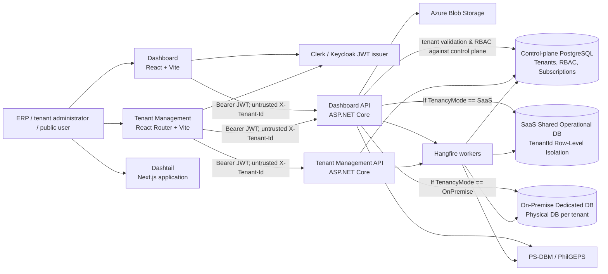
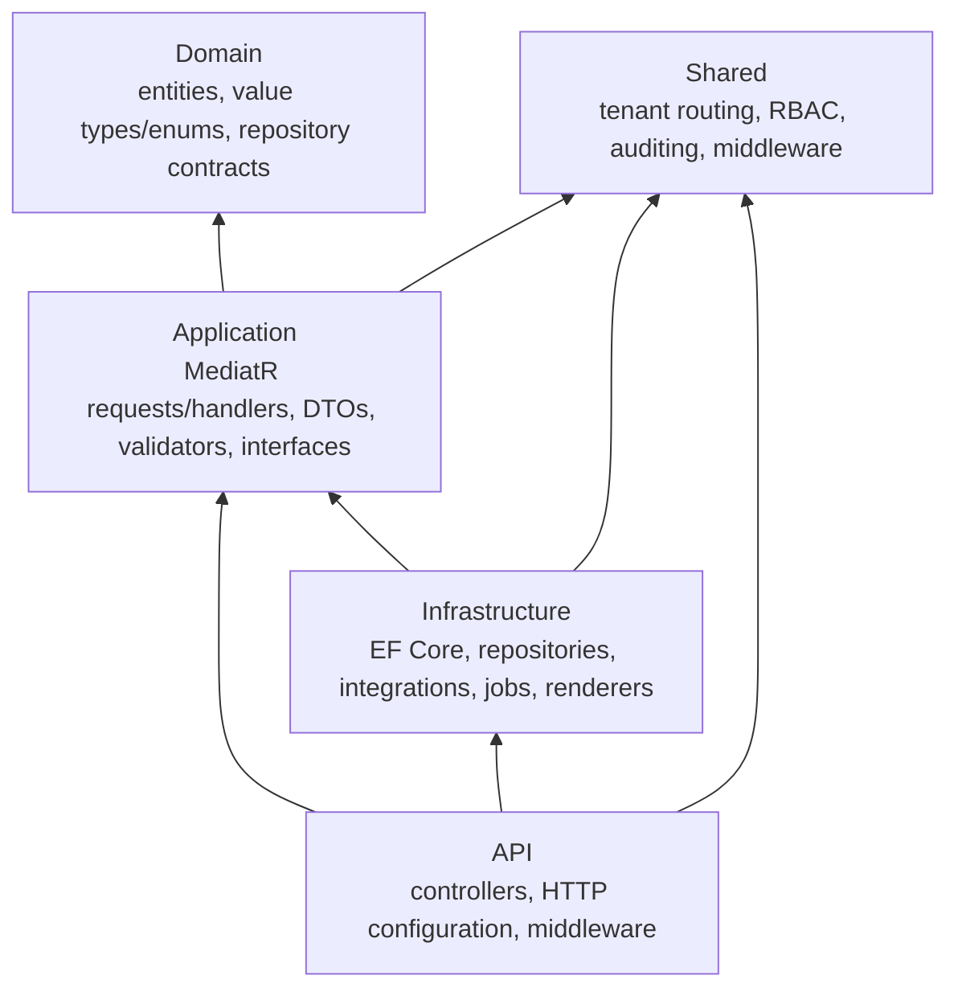
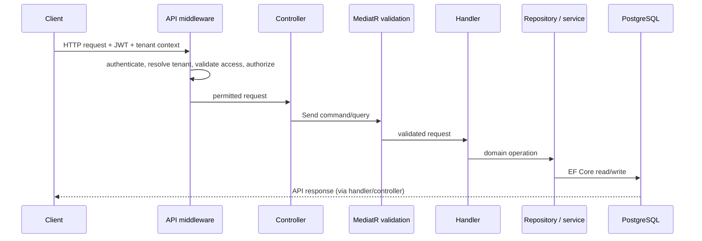

# ERPEZ System Architecture

> Current-state architecture, derived from the source tree on 11 September 2026. This describes what is implemented, not a target-state design. For local setup, see [PROJECT_MONOREPO_AND_RUN_GUIDE.md](PROJECT_MONOREPO_AND_RUN_GUIDE.md).

## 1. System at a glance

ERPEZ is a multi-tenant ERP monorepo. It contains two ASP.NET Core APIs, browser applications for ERP and tenant administration, and shared .NET/TypeScript libraries.



The Dashboard API references and registers `TenantManagement.Infrastructure`. Consequently, the ERP API can resolve tenant access, tenancy mode, and authorization directly against the control-plane database; this is an in-process project dependency, not an HTTP call to the Tenant Management API. Operational data access occurs strictly after tenant access evaluation is complete.

## 2. Repository and deployable units

| Area | Location | Responsibility |
| --- | --- | --- |
| ERP API | `apps/backend/Dashboard/Dashboard.Api` | Operational ERP HTTP API, public endpoints, document generation, PS-DBM integration, and scheduled sync registration. |
| Tenant Management API | `apps/backend/TenantManagement/TenantManagement.Api` | Tenant lifecycle, memberships, roles, subscriptions, licences, invoices, payment methods, and settings. |
| ERP dashboard | `apps/dashboard` | React 19/Vite UI using TanStack Router/Query and Keycloak. |
| Tenant-management UI | `apps/tenant-management` | React 19/React Router 7 UI for tenant and super-admin flows. |
| Dashtail | `apps/dashtail` | Separate Next.js application/design-system-style UI. Its runtime integration with the APIs is not established by the root composition. |
| Shared .NET code | `apps/backend/Shared` | Cross-cutting primitives: tenant context/routing, authorization, middleware, auditing, and shared persistence conventions. |
| Shared TypeScript | `packages/erpez-shared-lib`, `packages/ui`, `packages/types` | API/query helpers and reusable UI/types. `erpez-shared-lib` is consumed by both primary frontend applications. |

The JavaScript workspace is managed by pnpm and Turborepo (`pnpm-workspace.yaml`, `turbo.json`). The .NET solution is `apps/backend/ERPEZ.sln`. The active projects target .NET 10; package versions currently use ASP.NET/EF Core 9.x components in several places.

## 3. Backend architecture

Both bounded services use a Clean Architecture-style dependency direction:



### Request execution

Controllers are thin adapters: they bind an HTTP request and dispatch a command or query through MediatR (`ISender`/`IMediator`). The application layer registers all handlers plus FluentValidation. `ValidationBehavior<TRequest,TResponse>` runs validators before the handler. Queries that expose collections use Sieve processing where implemented. Handlers depend on repository and service interfaces; the infrastructure layer supplies EF Core repository/unit-of-work implementations.



### Domain coverage

The ERP application's top-level feature groups are `Auth`, `Dashboard`, `Planning`, and `Procurement`.

- Planning covers organizational structures, fiscal/budget data, WFP, OPCR/KPI, PPMP, APP, line-item budgets, and related document workflows.
- Procurement covers projects, requests/orders, RFQs, suppliers, BAC-related workflows, catalog/reference data, and PS-DBM synchronization.
- Tenant Management covers tenants, settings/modules, memberships, roles/permissions, subscriptions, licences, invoices, payment methods, and append-only tenant audit records.

The API exposes many resource-oriented controllers. Swagger is available in Development and is the practical endpoint inventory; controller route attributes remain the authoritative implementation detail.

## 4. Multi-tenancy, identity, and authorization

### 4.1. Hybrid Tenancy Architecture (SaaS & On-Premise)

ERPEZ supports a **Hybrid Multi-Tenancy Architecture** offering two distinct operational models while maintaining a unified domain codebase:

1. **Cloud SaaS Mode (`TenancyMode.SaaS`)**:
   - **Persistence**: Single shared operational PostgreSQL database (or pooled regional cluster).
   - **Isolation**: Logical row-level isolation via mandatory `TenantId` on all `TenantScopedEntity` tables, enforced automatically by EF Core runtime Global Query Filters and write-time interceptors.
   - **Provisioning**: Instant zero-touch workspace onboarding. No physical database DDL is executed on user signup.
   - **Routing**: `TenantConnectionResolver` routes all SaaS requests to the shared operational database connection string (`OperationalConnection`).

2. **Sovereign On-Premise Mode (`TenancyMode.OnPremise`)**:
   - **Persistence**: Dedicated physical database per tenant (`erpez_tenant_{tenantId}`).
   - **Isolation**: Physical database separation via dedicated credentials stored encrypted in `TenantOperationalDatabases`.
   - **Provisioning**: Asynchronous provisioning via Hangfire worker (`TenantDatabaseProvisioner`) that creates the physical PostgreSQL database and applies operational migrations.
   - **Routing**: `CachedTenantConnectionResolver` queries the control-plane database, decrypts credentials, and caches the tenant connection string.
   - **Defense in Depth**: Even in on-premise dedicated databases, entities still carry `TenantId` and enforce the same query filters and write validations, maintaining architectural symmetry across environments.

### 4.2. Request Lifecycle & Authoritative Security Boundary

The client-supplied `X-Tenant-Id` header is treated strictly as an **untrusted tenant selection request**. It never directly dictates database access.

```text
1. Client sends HTTP request with Bearer JWT and candidate X-Tenant-Id header.
2. Gateway / Ingress Proxy Validation: Ingress reverse proxies (e.g., NGINX, YARP, Envoy, Traefik) must strip or strictly validate client-supplied headers such as `X-Tenant-Name` to prevent spoofing before requests reach the internal service mesh.
3. TenantResolutionMiddleware extracts candidate tenant ID and user identity claims.
4. TenantAccessValidationMiddleware queries the Control Plane database:
   - Authenticates caller identity and tenant membership.
   - Validates tenant status (Active, not Disabled).
   - Resolves tenant TenancyMode (SaaS vs. OnPremise).
   - Invariant: Control-plane access is permitted during resolution; NO operational database interaction occurs before tenant validation succeeds.
5. TenantRequestContext is initialized as an authoritative scoped service with verified TenantId, TenancyMode, and permissions.
6. Display info resolution in `TenantContextController` enforces strict authoritative precedence: operational DB (`Organizations`) first, cryptographically signed JWT claims (`org_name`) second, and untrusted client headers strictly as sanitized fallbacks.
7. CachedTenantConnectionResolver resolves connection metadata:
   - If SaaS: Shared operational connection string.
   - If OnPremise: Dedicated operational connection string from TenantOperationalDatabases (with cache invalidation on tenant deactivation, credential rotation, or mode changes).
8. Operational ApplicationDbContext is initialized with CurrentTenantId = TenantRequestContext.TenantId.
```

### 4.3. Data Isolation & Write Enforcement

Operational entities are explicitly partitioned into two hierarchies (see [TENANT_ENTITY_CLASSIFICATION.md](TENANT_ENTITY_CLASSIFICATION.md)):
- **`TenantScopedEntity : BaseEntity`**: Business transactions, procurement documents, planning records, and office structures belonging to a specific tenant. Requires `TenantId`.
- **`BaseEntity`**: Global reference data, national standards (CSC Salary Grades, UACS Chart of Accounts), and national catalogs (PS-DBM products/depots). Shared across all tenants without `TenantId`.

**Isolation Mechanisms**:
- **Reads**: EF Core runtime Global Query Filter `e => e.TenantId == CurrentTenantId` dynamically evaluated per `DbContext` instance.
- **Writes**: `AuditingInterceptor` enforces strict tenant protection:
  - `Added`: `TenantId` is **always overwritten** with the authenticated `CurrentTenantId` (ignoring untrusted payloads).
  - `Modified`: `TenantId` is **strictly immutable**. Any mutation attempt throws a `SecurityException`.
  - `Deleted`: Soft-deletes and hard-deletes require `entry.Entity.TenantId == CurrentTenantId`.
- **Query Filter Bypasses**: Ordinary application services are prohibited from using `IgnoreQueryFilters()` on tenant-scoped operational data. Administrative tools or soft-delete lookups requiring filter overrides must explicitly preserve tenant filtering (`.Where(e => e.TenantId == CurrentTenantId)`).

### 4.4. Background Jobs (Hangfire) Tenant Isolation

Background workers operate outside HTTP request pipelines. Tenant context propagation is enforced deterministically:
- **`ITenantBackgroundScopeActivator` & `ITenantScopeFactory`**: Services can create isolated scopes (`CreateTenantScopeAsync(tenantId)` or `CreateGlobalScopeAsync()`) that resolve connection parameters and initialize `ITenantRequestContext` prior to `ApplicationDbContext` instantiation.
- **`HangfireTenantJobFilter` (`JobFilterAttribute, IServerFilter`)**: Automatically intercepts Hangfire jobs during `OnPerforming`.
  - When job arguments include a `Guid tenantId` or `ITenantScopedJob`, the filter activates the tenant's context and connection parameters in the job's service scope.
  - When no tenant parameter is present (e.g., PS-DBM catalogue sync), the filter activates the global system context, permitting access to global catalogs on the shared database while maintaining strict fail-closed protections.
- Tenancy must never be derived via unscoped database queries or hardcoded IDs.

### 4.5. RBAC Model

The shared `HasPermission` mechanism uses dynamic authorization policies and `PermissionAuthorizationHandler`.
- Subject identity comes from the JWT (`NameIdentifier` or `sub`).
- Global SuperAdmin claims can satisfy platform requirements.
- Standard users require an active tenant context and permissions validated through `IUserAuthorizationService` against the control plane.
- In-code static permission registries (`PlatformPermissions`, `TenantPermissions`) prevent dynamic database permission tampering.

## 5. Data, persistence, and lifecycle

PostgreSQL and EF Core/Npgsql are used across both planes:

| Database role | Owner / Context | Main contents | Tenancy Model |
| :--- | :--- | :--- | :--- |
| **Control plane** | `TenantManagement.Infrastructure.Persistence.ApplicationDbContext` | Tenant metadata, memberships, subscriptions, licenses, billing, and `TenantOperationalDatabases` credentials. | Dedicated control DB. Governs identity, mode, and entitlements. |
| **Operational plane (SaaS)** | `Dashboard.Infrastructure.Persistence.ApplicationDbContext` | ERP planning, procurement, office trees, and budgets for all SaaS tenants. | Single shared database with row-level `TenantId` isolation and composite uniqueness. |
| **Operational plane (On-Prem)** | `Dashboard.Infrastructure.Persistence.ApplicationDbContext` | ERP operational data for a single sovereign client. | Dedicated physical database (`erpez_tenant_{id}`). |
| **Global reference data** | `Dashboard.Infrastructure.Persistence.ApplicationDbContext` | PS-DBM product catalogs, UNSPSC codes, UOM, and national UACS chart of accounts. | Stored once in operational plane; globally queryable across all tenants. |

### 5.1. Existing-Data Migration Strategy

For environments with existing operational data, schema changes follow a deterministic, fail-closed multi-stage migration executed inside an atomic PostgreSQL transaction (`BEGIN ... COMMIT` with `ON_ERROR_STOP on`) or dedicated maintenance window:
1. **Schema Expansion**: Add `TenantId uuid NULL` to all `TenantScopedEntity` tables.
2. **Deterministic Provenance Backfill**: Backfill `TenantId` using verifiable audit logs or legacy tenant mappings. Defaulting records to an arbitrary tenant is strictly restricted to verified single-tenant legacy deployments. If data provenance cannot be proven, the migration fails closed.
3. **Integrity Validation**: Script verifies `SELECT COUNT(*) FROM {table} WHERE "TenantId" IS NULL` equals 0 across all tenant-scoped tables. Any non-zero count aborts the transaction immediately with rollback.
4. **Schema Enforcement**: Alter `TenantId` column to `NOT NULL`.
5. **Index Migration**: Replace single-column unique constraints with compound unique constraints (e.g., `(TenantId, Code)`, `(TenantId, Name)`).
6. **Filter Activation**: Enable EF Core Global Query Filters and write-time interceptor enforcement.

> [!IMPORTANT]
> **Production Database Initialization Routine**:
> In Development environments, EF Core automatically applies migrations on container boot. In contrast, Production deployment pipelines and database initialization routines intentionally omit runtime auto-migration on container startup to prevent concurrency races across replicas. Instead, production initialization and upgrade routines must execute the strict transactional migration script (`scripts/migrations/production-tenant-backfill-and-migration.sql`) using `run-production-migration.sh` (or `.ps1`) with `ON_ERROR_STOP on`.
> 
> Running within an atomic PostgreSQL transaction (`BEGIN ... COMMIT`) guarantees:
> 1. Large legacy single-tenant datasets across all 136 operational tables are deterministically backfilled to the verified target `TenantId`.
> 2. Fail-closed assertion queries verify that zero records remain with `NULL` or empty GUIDs before applying `NOT NULL` constraints.
> 3. If any statement or constraint fails, the entire transaction aborts atomically with `ROLLBACK`, completely eliminating partial state failures, data invisibility, or un-scoped operational records.

## 6. Cross-cutting runtime services

| Capability | Current implementation |
| --- | --- |
| Authentication | JWT bearer authentication; frontends use Keycloak JS. |
| Error handling | ASP.NET Core exception handler plus Problem Details. |
| API usability | Development-only Swagger/OpenAPI; JSON string enum conversion. |
| Delivery/proxying | Forwarded headers, environment-named CORS policy, HTTPS redirection outside Development. |
| Performance | Response caching and compression; in-memory cache used by tenant services. |
| Background work | Hangfire server and PostgreSQL-backed Hangfire storage in both APIs. |
| Scheduled integration | Dashboard API schedules PS-DBM full catalogue sync daily at 02:00 and stock sync at 08:00, 12:00, and 16:00 Asia/Manila time. |
| Files and documents | Azure Blob-backed file storage; local document storage; QuestPDF/ClosedXML renderers for ERP documents. |
| Imports | CSV/Excel import services including UACS, fund sources, and positions; temporary-file cleanup hosted service. |

## 7. Hosting and configuration

Configuration is loaded from `appsettings.json`, an environment-specific appsettings file, and .NET user secrets. Container compose files provide `ConnectionStrings__DefaultConnection`; the Dashboard compose file also supplies `AzureBlobStorage__ConnectionString`. Both API compose definitions join external `web-network` and `data-network` networks.

Important configuration categories are:

- `ConnectionStrings:DefaultConnection` — control-plane connection and the development fallback; Dashboard's tenant provider normally switches to the authorized operational connection per request.
- `TenantRouting` — governs whether the development fallback is allowed.
- `JwtSettings` — authority/audience configuration for external identity-provider use.
- `Cors` — environment-specific frontend origin policy.
- `AzureBlobStorage` — file container and connection settings.

Secrets must remain outside source control, using user secrets locally and deployment secret injection in hosted environments.

## 8. Current architecture considerations

These are observations to keep visible when evolving the system:

- **Service coupling:** Dashboard API references Tenant Management infrastructure directly. Changing control-plane contracts or persistence can affect both API deployments; this is not independently versioned inter-service communication.
- **Database routing:** Correct tenant isolation depends on the tenant-resolution/access middleware running before application data access. Code that constructs the operational context outside a request needs an explicitly authorized context or the narrowly enabled Development fallback.
- **Background jobs:** Both APIs host Hangfire against PostgreSQL. Dashboard recurring PS-DBM jobs require the host to run and need a defined tenant/data context for their operational writes.
- **JWT configuration:** the current authentication extension disables issuer, audience, and lifetime validation and contains a development signing-key fallback. Treat this as development-oriented behavior and harden it before exposing the API to untrusted production traffic.
- **Documentation drift:** older root documents refer to an `ERPEZ/` backend path and .NET 8/9. The current solution uses `Dashboard/`, `TenantManagement/`, and .NET 10 project targets; this document follows the checked-in implementation.

## 9. Key implementation entry points

- API startup: `apps/backend/Dashboard/Dashboard.Api/Program.cs` and `apps/backend/TenantManagement/TenantManagement.Api/Program.cs`
- API pipeline: each API's `Extensions/MiddlewareExtensions.cs`
- Tenant access: `apps/backend/Shared/Services/TenantConnectionProvider.cs` and `TenantRequestContext.cs`
- Authorization: `apps/backend/Shared/Authorization/PermissionAuthorizationHandler.cs`
- ERP registrations: `apps/backend/Dashboard/Dashboard.Infrastructure/DependencyInjection.cs`
- Tenant-management registrations: `apps/backend/TenantManagement/TenantManagement.Infrastructure/DependencyInjection.cs`
- Persistence models/mappings: each infrastructure project's `Persistence/ApplicationDbContext.cs`
