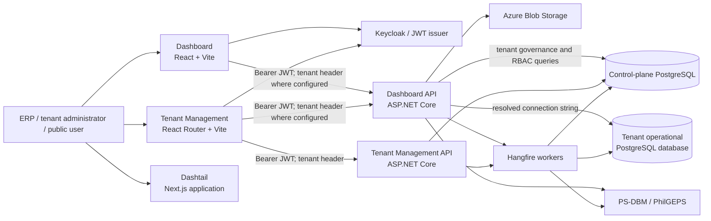
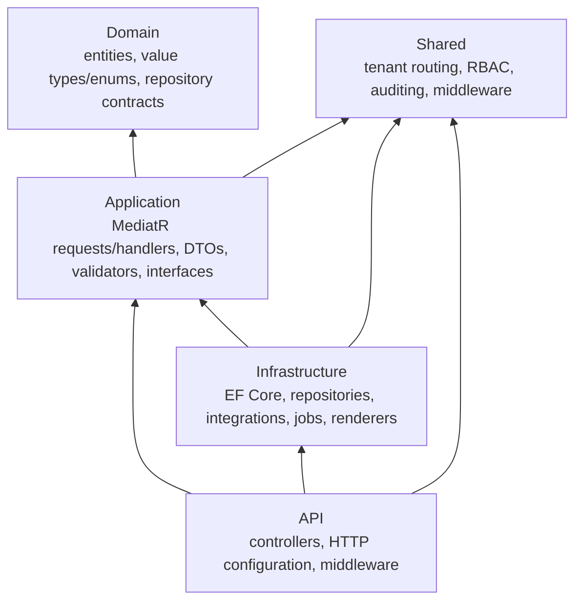
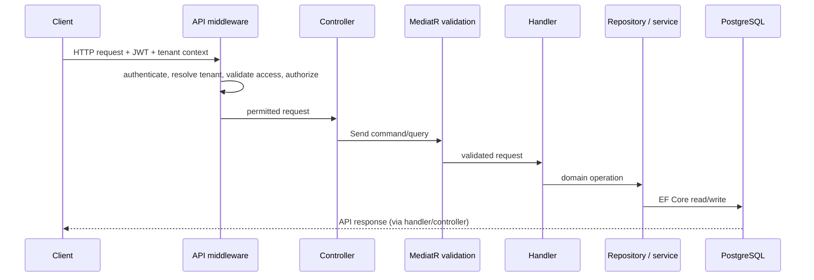

# ERPEZ System Architecture

> Current-state architecture, derived from the source tree on 11 September 2026. This describes what is implemented, not a target-state design. For local setup, see [PROJECT_MONOREPO_AND_RUN_GUIDE.md](PROJECT_MONOREPO_AND_RUN_GUIDE.md).

## 1. System at a glance

ERPEZ is a multi-tenant ERP monorepo. It contains two ASP.NET Core APIs, browser applications for ERP and tenant administration, and shared .NET/TypeScript libraries.

The Dashboard API also references and registers `TenantManagement.Infrastructure`. Consequently, the ERP API can resolve tenant access and authorization directly against the control-plane database; this is currently an in-process project dependency, not an HTTP call to the Tenant Management API.

## 2. Repository and deployable units

| Area | Location | Responsibility |
| --- | --- | --- |
| ERP API | `apps/backend/Dashboard/Dashboard.Api` | Operational ERP HTTP API, public endpoints, document generation, PS-DBM integration, and scheduled sync registration. |
| Tenant Management API | `apps/backend/TenantManagement/TenantManagement.Api` | Tenant lifecycle, memberships, roles, subscriptions, licences, invoices, payment methods, and settings. |
| ERP dashboard | `apps/dashboard` | React 19/Vite UI using TanStack Router/Query and Keycloak. |
| Tenant-management UI | `apps/tenant-management` | React 19/React Router 7 UI for tenant and super-admin flows. |
| Dashtail | `apps/dashtail` | Separate Next.js application/design-system-style UI. Its runtime integration with the APIs is not established by the root composition. |
| Shared .NET code | `apps/backend/Shared` | Cross-cutting primitives: tenant context/routing, authorization, middleware, auditing, and shared persistence conventions. |
| Shared TypeScript | `packages/erpez-shared-lib`, `packages/ui`, `packages/types` | API/query helpers and reusable UI/types. `erpez-shared-lib` is consumed by both primary frontend applications. |

The JavaScript workspace is managed by pnpm and Turborepo (`pnpm-workspace.yaml`, `turbo.json`). The .NET solution is `apps/backend/ERPEZ.sln`. The active projects target .NET 10; package versions currently use ASP.NET/EF Core 9.x components in several places.

## 3. Backend architecture

Both bounded services use a Clean Architecture-style dependency direction:

### Request execution

Controllers are thin adapters: they bind an HTTP request and dispatch a command or query through MediatR (`ISender`/`IMediator`). The application layer registers all handlers plus FluentValidation. `ValidationBehavior<TRequest,TResponse>` runs validators before the handler. Queries that expose collections use Sieve processing where implemented. Handlers depend on repository and service interfaces; the infrastructure layer supplies EF Core repository/unit-of-work implementations.

### Domain coverage

The ERP application's top-level feature groups are `Auth`, `Dashboard`, `Planning`, and `Procurement`.

- Planning covers organizational structures, fiscal/budget data, WFP, OPCR/KPI, PPMP, APP, line-item budgets, and related document workflows.
- Procurement covers projects, requests/orders, RFQs, suppliers, BAC-related workflows, catalog/reference data, and PS-DBM synchronization.
- Tenant Management covers tenants, settings/modules, memberships, roles/permissions, subscriptions, licences, invoices, payment methods, and append-only tenant audit records.

The API exposes many resource-oriented controllers. Swagger is available in Development and is the practical endpoint inventory; controller route attributes remain the authoritative implementation detail.

## 4. Multi-tenancy, identity, and authorization

### Tenant routing model

Tenant Management acts as a control plane. It stores tenant metadata and the information required to authorize a tenant request. The Dashboard API's operational `ApplicationDbContext` gets its connection string from a scoped `ITenantConnectionProvider`.

1. JWT authentication establishes the caller identity.
2. `TenantResolutionMiddleware` extracts a candidate tenant from JWT claims or the request header and rejects conflicts.
3. `TenantAccessValidationMiddleware` validates tenant-access invariants and initializes `TenantRequestContext` with authorized tenant and connection information.
4. `TenantConnectionProvider` returns that scoped connection string to the ERP EF Core context.
5. If no authorized context exists, the provider fails closed. A default connection is permitted only in Development when `TenantRouting:AllowDevelopmentFallback` is enabled.

This gives the operational ERP data plane database-per-tenant behavior at request scope, while the tenant-management database remains the central control plane.

### RBAC model

The shared `HasPermission` mechanism uses dynamic authorization policies and `PermissionAuthorizationHandler`.

- The subject comes from the JWT `NameIdentifier` or `sub` claim.
- A super-admin claim/role can satisfy a requirement globally.
- Other callers require a resolved tenant plus a permission validated through `IUserAuthorizationService`.
- Permission checks fail closed when identity or tenant context is missing.

Frontend clients attach Keycloak access tokens; the tenant-management UI additionally sends `X-Tenant-Id`. UI guards improve navigation behavior, but the API permission attributes and middleware are the security boundary.

## 5. Data, persistence, and lifecycle

PostgreSQL and EF Core/Npgsql are used by both services. Each service owns an `ApplicationDbContext`, migrations, repositories, and a unit of work.

| Database role | Owner/context | Main contents |
| --- | --- | --- |
| Control plane | `TenantManagement.Infrastructure.Persistence.ApplicationDbContext` | Tenant configuration, membership and RBAC catalogue/assignments, subscriptions, licences, billing/payment records, audit log. |
| Operational tenant plane | `Dashboard.Infrastructure.Persistence.ApplicationDbContext` | ERP planning, procurement, reference/master, financial, workflow, and PS-DBM catalog/sync data for the resolved tenant. |

Persistence-wide conventions are supplied by `AuditingInterceptor`: it sets creator/updater timestamps and users, converts soft-deletable deletes to updates, and normalizes unspecified `DateTime` values to UTC. `TenantAuditLog` is specifically enforced as append-only by the control-plane context.

Development startup attempts to migrate and seed both contexts. The Dashboard API also seeds procurement test data on startup. Production migration execution should therefore be treated as an explicit deployment concern rather than assumed from the application startup path.

## 6. Cross-cutting runtime services

| Capability | Current implementation |
| --- | --- |
| Authentication | JWT bearer authentication; frontends use Keycloak JS. |
| Error handling | ASP.NET Core exception handler plus Problem Details. |
| API usability | Development-only Swagger/OpenAPI; JSON string enum conversion. |
| Delivery/proxying | Forwarded headers, environment-named CORS policy, HTTPS redirection outside Development. |
| Performance | Response caching and compression; in-memory cache used by tenant services. |
| Background work | Hangfire server and PostgreSQL-backed Hangfire storage in both APIs. |
| Scheduled integration | Dashboard API schedules PS-DBM full catalogue sync daily at 02:00 and stock sync at 08:00, 12:00, and 16:00 Asia/Manila time. |
| Files and documents | Azure Blob-backed file storage; local document storage; QuestPDF/ClosedXML renderers for ERP documents. |
| Imports | CSV/Excel import services including UACS, fund sources, and positions; temporary-file cleanup hosted service. |

## 7. Hosting and configuration

Configuration is loaded from `appsettings.json`, an environment-specific appsettings file, and .NET user secrets. Container compose files provide `ConnectionStrings__DefaultConnection`; the Dashboard compose file also supplies `AzureBlobStorage__ConnectionString`. Both API compose definitions join external `web-network` and `data-network` networks.

Important configuration categories are:

- `ConnectionStrings:DefaultConnection` — control-plane connection and the development fallback; Dashboard's tenant provider normally switches to the authorized operational connection per request.
- `TenantRouting` — governs whether the development fallback is allowed.
- `JwtSettings` — authority/audience configuration for external identity-provider use.
- `Cors` — environment-specific frontend origin policy.
- `AzureBlobStorage` — file container and connection settings.

Secrets must remain outside source control, using user secrets locally and deployment secret injection in hosted environments.

## 8. Current architecture considerations

These are observations to keep visible when evolving the system:

- **Service coupling:** Dashboard API references Tenant Management infrastructure directly. Changing control-plane contracts or persistence can affect both API deployments; this is not independently versioned inter-service communication.
- **Database routing:** Correct tenant isolation depends on the tenant-resolution/access middleware running before application data access. Code that constructs the operational context outside a request needs an explicitly authorized context or the narrowly enabled Development fallback.
- **Background jobs:** Both APIs host Hangfire against PostgreSQL. Dashboard recurring PS-DBM jobs require the host to run and need a defined tenant/data context for their operational writes.
- **JWT configuration:** the current authentication extension disables issuer, audience, and lifetime validation and contains a development signing-key fallback. Treat this as development-oriented behavior and harden it before exposing the API to untrusted production traffic.
- **Documentation drift:** older root documents refer to an `ERPEZ/` backend path and .NET 8/9. The current solution uses `Dashboard/`, `TenantManagement/`, and .NET 10 project targets; this document follows the checked-in implementation.

## 9. Key implementation entry points

- API startup: `apps/backend/Dashboard/Dashboard.Api/Program.cs` and `apps/backend/TenantManagement/TenantManagement.Api/Program.cs`
- API pipeline: each API's `Extensions/MiddlewareExtensions.cs`
- Tenant access: `apps/backend/Shared/Services/TenantConnectionProvider.cs` and `TenantRequestContext.cs`
- Authorization: `apps/backend/Shared/Authorization/PermissionAuthorizationHandler.cs`
- ERP registrations: `apps/backend/Dashboard/Dashboard.Infrastructure/DependencyInjection.cs`
- Tenant-management registrations: `apps/backend/TenantManagement/TenantManagement.Infrastructure/DependencyInjection.cs`
- Persistence models/mappings: each infrastructure project's `Persistence/ApplicationDbContext.cs`
