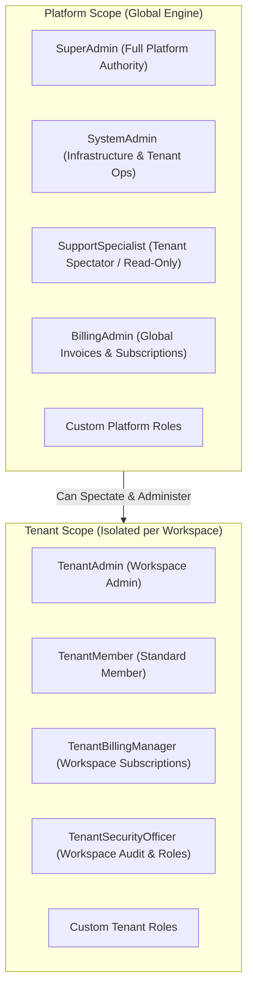
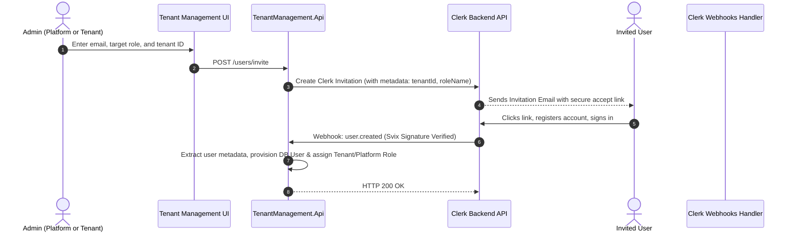
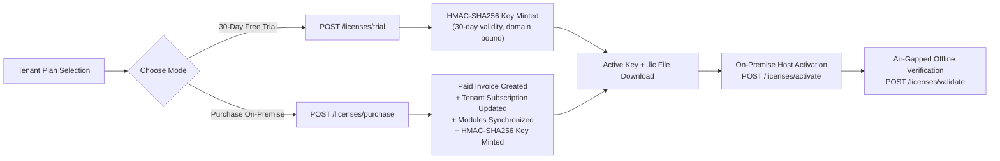

# Tenant Management Portal: Comprehensive Architecture & Implementation Summary

## 1. Executive Summary & Architectural Scope

The **Tenant Management Portal** provides a multi-tenant administration and self-service provisioning system. It governs tenant lifecycles, user authentication, access control policies, billing, subscriptions, and cryptographic licensing for both **Cloud SaaS** and **Sovereign Air-Gapped On-Premise** deployments.

### Key Architectural Invariants
* **Strict Domain Isolation**: The Tenant Management Portal manages workspaces, subscriptions, billing, and global users. Operational ERP applications (Dashboard, Planning, Procurement) run in isolated child domains without direct coupling.
* **Clerk-Only Identity Provider**: All authentication and identity management is governed through Clerk. Complex dual-IdP Keycloak overhead was eliminated from the Tenant Management boundary.
* **Declarative In-Code Permissions**: Dynamic database permission tables were eliminated in favor of high-performance, tamper-proof, in-code static permission registries.
* **Cross-Tenant Isolation**: Tenant A cannot access Tenant B resources, even in shared multi-tenant SaaS databases. Every query is scoped via `ITenantContext`.
* **Unified Subscription & License Model**: **1 Subscription = 1 Entitlement = 1 Cryptographic Key**. Cloud SaaS provisions zero-touch; On-Premise provisions portable, signed `.lic` cryptographic certificates.
* **All Enums Persisted as Strings**: All database entities enforce string conversions (`HasConversion<string>()`) for clean schema portability and readability.

---

## 2. Authentication & Dual-Scope Access Control (RBAC)

### 2.1 Dual Role Scopes
Access is segregated into two scopes:



### 2.2 In-Code Permissions Registry
Permissions are statically defined, strongly typed constants:

* **Platform Permissions** (`PlatformPermissions.cs`):
  * `platform.tenants.view`, `platform.tenants.create`, `platform.tenants.manage`, `platform.tenants.delete`
  * `platform.users.view`, `platform.users.invite`, `platform.users.manage`
  * `platform.roles.view`, `platform.roles.manage`
  * `platform.billing.view`, `platform.billing.manage`
  * `platform.spectate.enter`
* **Tenant Permissions** (`TenantPermissions.cs`):
  * `tenant.workspace.view`, `tenant.workspace.manage`
  * `tenant.members.view`, `tenant.members.invite`, `tenant.members.manage`
  * `tenant.roles.view`, `tenant.roles.manage`
  * `tenant.billing.view`, `tenant.billing.manage`
  * `tenant.licenses.view`, `tenant.licenses.manage`
  * `tenant.audit.view`

### 2.3 Policy-Driven API Security
ASP.NET Core Authorization Policies (`TenantPolicies.cs`) enforce permissions via declarative attributes:
```csharp
[Authorize(Policy = TenantPolicies.LicensesManage)]
[HttpPost("purchase")]
public async Task<ActionResult<ApiResponse<PurchaseLicenseResult>>> PurchaseLicense(...)
```

---

## 3. User Invitation & Automated Webhook Provisioning

### 3.1 Invitation Flow
To avoid reliance on Clerk Organizations, user invitations use standard Clerk Email Invitations:



---

## 4. Unified Subscription & Cryptographic License System

### 4.1 Symmetric 3-Tier Plan Bundles
Cloud SaaS and Sovereign On-Premise share symmetric plan tiers with strict feature and capacity gating:

| Tier | Cloud SaaS Price | On-Premise Price | Core Modules | Target Architecture |
| :--- | :--- | :--- | :--- | :--- |
| **Starter** | $79 / month ($790/yr) | $1,990 / year | `ams`, `sams` | Single subsidiary, core financials & asset tracking |
| **Professional** | $199 / month ($1,990/yr) | $4,990 / year | `ams`, `sams`, `pms`, `pbms` | Multi-subsidiary, supply chain, manufacturing, procurement |
| **Enterprise** | $499 / month ($4,990/yr) | Custom / Contact | `ams`, `sams`, `pms`, `pbms` + Sovereign Add-ons | Multi-subsidiary, air-gapped cluster, custom SLA & failover |

### 4.2 Module Entitlement Mapping
Modules are synchronized to the tenant record upon plan purchase or subscription change:
* `ams`: Asset Management System
* `sams`: Stock & Asset Management System
* `pms`: Procurement Management System
* `pbms`: Public Bidding Management System

---

## 5. Self-Service Licensing & Verification Engine

### 5.1 License Lifecycle & Operations



### 5.2 Endpoints Implemented

1. **`POST /licenses/trial`**:
   - Provisions an instant 30-day trial without credit card requirement.
   - Restricts to 1 active trial per tenant.
   - Binds to current host domain.

2. **`POST /licenses/purchase`**:
   - Validates payment method.
   - Creates and settles `TenantInvoice` (marked `Paid`).
   - Establishes/updates `TenantSubscription`.
   - Synchronizes module entitlements (`tenant.Modules`).
   - Mints a tamper-proof HMAC key (`LicenseKey` entity).
   - Updates `TenantSetting.ActiveLicenseKey`.

3. **`POST /licenses/activate`**:
   - Validates cryptographic key structure, signature checksum, expiry, and allowed domain.
   - Binds the active key to the tenant's on-premise installation.

4. **`POST /licenses/validate`**:
   - Offline-capable validation logic matching domain rules:
     - Exact match (`erp.client.com`)
     - Wildcard domain (`*.client.com`)
     - Global unconstrained (`*`)

### 5.3 Cryptographic License Certificate (`.lic`)
When purchasing or exporting, the system delivers an authoritative JSON certificate:
```json
{
  "product": "ERPez Sovereign On-Premise",
  "version": "2.0",
  "key": "EPZ-PRO-20270929-ABCD-1234",
  "prefix": "EPZ",
  "tenantId": "d3b07384-d113-4c57-a123-228794827011",
  "boundEmail": "admin@tenantcorp.com",
  "plan": "Professional",
  "allowedDomain": "erp.tenantcorp.com",
  "maxTenants": 1,
  "maxUsers": 50,
  "issuedAt": "2026-09-29T06:40:00Z",
  "expiresAt": "2027-09-29T06:40:00Z",
  "isAirGapped": true,
  "signature": "HMAC_SHA256_VERIFIED"
}
```

---

## 6. Frontend Components & User Experience

### 6.1 Plan Selection Page (`plan.tsx`)
* Seamless tab switching between **Cloud SaaS** and **Sovereign On-Premise** architectures.
* Dynamic pricing toggle (Monthly vs. Annual with 2 months free).
* Direct launch of `PurchaseLicenseModal` upon selecting an on-premise tier.

### 6.2 License Management Dashboard (`LicenseManagement.tsx`)
* **Real-Time Domain Constraint Verification**: Visual green/red badge warning if accessing the portal from an unauthorized domain.
* **Instant Key Actions**: One-click key copying and `.lic` certificate file download.
* **Active Entitlement Grid**: Shows remaining days, deployment plan, air-gapped status, and user capacity limits.
* **Offline Activation Form**: Offline activation of key strings.

### 6.3 Purchase License Modal (`PurchaseLicenseModal.tsx`)
* Tier selection (Starter vs. Professional) and billing interval selection.
* Domain constraint configuration (`allowedDomain`).
* Automatic payment method detection with an inline credit card submission form.
* Step-by-step progress tracking: Invoice settlement -> Subscription creation -> HMAC generation -> Instant key revelation and `.lic` download.

### 6.4 Access Control & User Management
* **Roles Management View (`RolesManagementView.tsx`)**: Granular permission matrix display and custom role creation.
* **User Management & Invitations (`InviteUserModal.tsx`)**: Email-based Clerk invitations mapped to tenant/platform roles.

---

## 7. Verification & Build Health

| Test Suite / Build Step | Tool | Result |
| :--- | :--- | :--- |
| **Backend Unit Tests** | `dotnet test` | **213 Passed, 0 Failed, 0 Skipped** (1.0s) |
| **Frontend Production Build** | `npm.cmd run build` (Vite) | **Compiled with exit code 0** (all chunks generated) |
| **Git Working Tree** | `git status` | Clean, 0 uncommitted changes |
| **Remote Synchronization** | `git push` | Pushed commit `13de9609` to `origin/feature/prod-ready-updates` |
| **Merge Simulation** | `git merge-tree` against `origin/development` | **0 Merge Conflicts** |
