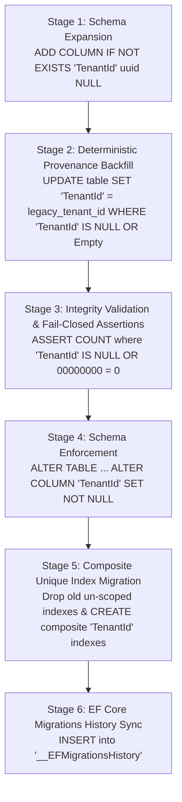

# ERPEZ Production Multi-Stage Tenant Migration & Index Enactment

This directory contains the production-grade migration scripts and execution runners implementing the strategy defined in [SYSTEM_ARCHITECTURE.md](../../SYSTEM_ARCHITECTURE.md) (§5.1 Existing-Data Migration Strategy) and addressing PR review recommendations:

1. **Recommendation 1**: Ensure production deployment runs the multi-stage migration scripts detailed in `SYSTEM_ARCHITECTURE.md` to backfill and enforce `NOT NULL` constraints on `TenantId` columns without breaking existing single-tenant legacy records or causing data invisibility under EF Core global query filters.
2. **Recommendation 2**: Verify and generate composite unique indexes (e.g. `("TenantId", "Code")`, `("TenantId", "PONumber")`) on all tenant-scoped operational tables during migration execution to prevent unique constraint collisions across different tenants.

---

## Architecture Context & Problem Solved

### The Single-Tenant Legacy Gap
When transitioning from a single-tenant architecture to a multi-tenant SaaS / hybrid on-premises architecture, tables require a `TenantId` column. If an auto-generated EF Core migration is run directly against an existing database, existing records get stamped with `Guid.Empty` (`00000000-0000-0000-0000-000000000000`). Because EF Core uses Global Query Filters (`e.TenantId == CurrentTenantId`), all legacy operational records become immediately invisible to the tenant.

### Cross-Tenant Collision Gap
If unique indexes remain single-column or un-scoped by `TenantId` (e.g., unique on `PONumber` or `(OfficeId, FiscalYearId)`), Tenant A creating `PO-2026-001` blocks Tenant B from creating `PO-2026-001`. All operational entity unique constraints must be scoped by `TenantId`.

---

## Multi-Stage Migration Pipeline

The script [`production-tenant-backfill-and-migration.sql`](./production-tenant-backfill-and-migration.sql) executes inside an atomic PostgreSQL transaction (`BEGIN ... COMMIT`) following 6 fail-closed stages across **136 operational tables** in both `planning` and `procurement` schemas:



1. **Stage 1 (Schema Expansion)**: Adds `"TenantId" uuid NULL` to all operational tables if not already present.
2. **Stage 2 (Deterministic Provenance Backfill)**: Backfills any `NULL` or `00000000-0000-0000-0000-000000000000` values to the verified target `legacy_tenant_id`.
3. **Stage 3 (Integrity Validation / Fail-Closed)**: Runs validation queries across all 136 tables. If any row has `NULL` or all-zero `TenantId`, the transaction immediately aborts (`RAISE EXCEPTION`) and rolls back.
4. **Stage 4 (Schema Enforcement)**: Enforces `ALTER COLUMN "TenantId" SET NOT NULL` and drops any default `Guid.Empty` values.
5. **Stage 5 (Index Migration)**: Drops legacy single-column unique indexes and creates composite `("TenantId", ...)` indexes.
6. **Stage 6 (EF Core Migrations History)**: Records both migrations in `__EFMigrationsHistory`:
   - `20261006055923_AddTenantIdToOperationalEntities`
   - `20261007010656_AddCompositeTenantIndexesToOperationalEntities`

---

## Operational Entities with Composite Unique Indexes

The following 22 entity unique constraints were upgraded to composite `TenantId` indexes:

| Schema | Table | Composite Unique Index Columns | Soft Delete Filter |
| :--- | :--- | :--- | :--- |
| `procurement` | `PurchaseOrders` | `("TenantId", "PONumber")` | Yes (`"IsDeleted" = false`) |
| `planning` | `Clusters` | `("TenantId", "Name")` | Yes (`"IsDeleted" = false`) |
| `planning` | `Locations` | `("TenantId", "Name", "Code")` | Yes (`"IsDeleted" = false`) |
| `planning` | `MFOPAPs` | `("TenantId", "Name", "Code")` | Yes (`"IsDeleted" = false`) |
| `planning` | `PerformanceMeasures` | `("TenantId", "Name")` | Yes (`"IsDeleted" = false`) |
| `planning` | `FiscalYears` | `("TenantId", "Year")` | Yes (`"IsDeleted" = false`) |
| `planning` | `FiscalMonths` | `("TenantId", "FiscalYearId", "MonthIndex")` | Yes (`"IsDeleted" = false`) |
| `planning` | `Transactions` | `("TenantId", "FundSourceId", "OrganizationId", "LocationId", "MFOPAPId", "ObjectId", "TransactionDate")` | No |
| `planning` | `WorkflowMatrices` | `("TenantId", "FiscalYearId", "OfficeId", "DocumentType")` & `("TenantId", "FiscalYearId", "OfficeId")` | Yes (`"IsDeleted" = false`) |
| `planning` | `WFPObjectives` | `("TenantId", "WFPId", "Description")` | Yes (`"IsDeleted" = false`) |
| `planning` | `WFPObjectiveTimelines`| `("TenantId", "WFPObjectiveActivityId", "StartDate", "EndDate")` | Yes (`"IsDeleted" = false`) |
| `planning` | `WFPPAPDepartments` | `("TenantId", "WFPPAPId", "DeliveryUnitId")` | Yes (`"IsDeleted" = false`) |
| `planning` | `OPCRs` | `("TenantId", "OfficeId", "FiscalYearId")` | Yes (`"IsDeleted" = false`) |
| `planning` | `OPCRPAPDepartments` | `("TenantId", "OPCRActivityId", "OfficeId")` | Yes (`"IsDeleted" = false`) |
| `planning` | `OPCRActivities` | `("TenantId", "OPCRItemId", "Name")` | Yes (`"IsDeleted" = false`) |
| `planning` | `OPCRRatings` | `("TenantId", "OPCREvaluationId", "PerformanceMeasureId", "OPCRId", "DUKPITargetAssignmentId")` | Yes (`"IsDeleted" = false`) |
| `planning` | `OPCRItems` | `("TenantId", "OPCRId", "KPIAssignmentId")` | Yes (`"IsDeleted" = false`) |
| `planning` | `KPITargets` | `("TenantId", "KPIId", "Period", "QuarterName")` | Yes (`"IsDeleted" = false`) |
| `planning` | `KPIModeOfVerifications`| `("TenantId", "KPIId", "Name")` | Yes (`"IsDeleted" = false`) |
| `planning` | `KPIPerformanceMeasures`| `("TenantId", "KPIId", "PerformanceMeasureId")` | Yes (`"IsDeleted" = false`) |
| `planning` | `Ratings` | `("TenantId", "KPIPerformanceMeasureId", "NumericalRating")` | Yes (`"IsDeleted" = false`) |
| `planning` | `FunctionAllocations` | `("TenantId", "FunctionType", "FiscalYearId")` | Yes (`"IsDeleted" = false`) |

---

## How to Run

### Step 1: Obtain the Verified Legacy Tenant ID
Query the control plane database to obtain the GUID of the target tenant to whom legacy single-tenant data belongs:
```sql
SELECT "Id", "Name", "Slug" FROM tenants WHERE "Slug" = 'primary-workspace';
```

### Step 2: Execute Migration

#### Using PowerShell (Windows / CI runner)
```powershell
.\scripts\migrations\run-production-migration.ps1 `
  -TenantId "01a0d69d-924b-762c-a774-523a30544619" `
  -Host "db.prod.internal" `
  -Port 5432 `
  -Database "erpez_operational" `
  -Username "postgres"
```

#### Using Bash (Linux / Docker / CI runner)
```bash
./scripts/migrations/run-production-migration.sh \
  --tenant-id "01a0d69d-924b-762c-a774-523a30544619" \
  --host "db.prod.internal" \
  --port 5432 \
  --database "erpez_operational" \
  --username "postgres"
```

#### Direct Execution via `psql`
```bash
psql -h db.prod.internal -U postgres -d erpez_operational \
  -v ON_ERROR_STOP=1 \
  -c "SET erpez.legacy_tenant_id = '01a0d69d-924b-762c-a774-523a30544619';" \
  -f scripts/migrations/production-tenant-backfill-and-migration.sql
```

---

## Verification & Post-Migration Health Checks

### Check for any Unassigned / NULL TenantIds
Run the following query against the operational database; the count must be 0:
```sql
DO $$
DECLARE
    tbl text;
    unassigned_count bigint;
BEGIN
    FOR tbl IN
        SELECT table_schema || '."' || table_name || '"'
        FROM information_schema.columns
        WHERE column_name = 'TenantId'
          AND table_schema IN ('planning', 'procurement')
    LOOP
        EXECUTE format('SELECT COUNT(*) FROM %s WHERE "TenantId" IS NULL OR "TenantId" = ''00000000-0000-0000-0000-000000000000''', tbl)
        INTO unassigned_count;

        IF unassigned_count > 0 THEN
            RAISE EXCEPTION 'Table % has % unassigned records!', tbl, unassigned_count;
        END IF;
    END LOOP;
    RAISE NOTICE 'SUCCESS: All tenant tables have 100%% deterministic TenantId assignment.';
END $$;
```

### Verify Composite Unique Indexes Exist
```sql
SELECT
    schemaname,
    tablename,
    indexname,
    indexdef
FROM pg_indexes
WHERE schemaname IN ('planning', 'procurement')
  AND indexdef LIKE '%UNIQUE INDEX%'
  AND indexdef LIKE '%TenantId%'
ORDER BY tablename, indexname;
```
