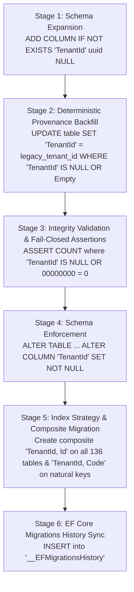

# ERPEZ Production Multi-Stage Tenant Migration, Index Strategy & Staging Verification

This directory contains the production-grade migration scripts, execution runners, and staging verification tooling implementing the strategy defined in [SYSTEM_ARCHITECTURE.md](../../SYSTEM_ARCHITECTURE.md) (§5.1 Existing-Data Migration Strategy) and addressing PR review recommendations:

1. **Recommendation 1: Multi-Stage Migration & Backfill Strategy**
   Ensure production deployment runs the multi-stage migration scripts detailed in `SYSTEM_ARCHITECTURE.md` to backfill and enforce `NOT NULL` constraints on `TenantId` columns without breaking existing single-tenant legacy records or causing data invisibility under EF Core global query filters.

2. **Recommendation 2: Composite Unique Indexes & Collision Prevention**
   Verify and generate composite unique indexes (e.g. `("TenantId", "Code")`, `("TenantId", "PONumber")`) on all tenant-scoped operational tables during migration execution to prevent unique constraint collisions across different tenants.

3. **Recommendation 3: Index Strategy for Global Query Filter Performance**
   Ensure that all newly introduced `TenantId` columns on high-volume tables have corresponding composite indexes (`("TenantId", "Id")` and `("TenantId", "Code")`) to prevent full table scans when global query filters (`e.TenantId == CurrentTenantId`) are evaluated by EF Core.

4. **Recommendation 4: Staging Migration Verification**
   Verify that staging environments execute the multi-stage migration strategy smoothly, specifically asserting that **zero records are left with a null or empty TenantId** before applying constraints.

---

## 1. Architecture Context & Problems Solved

### The Single-Tenant Legacy Gap
When transitioning from a single-tenant architecture to a multi-tenant SaaS / hybrid on-premises architecture, tables require a `TenantId` column. If an auto-generated EF Core migration is run directly against an existing database, existing records get stamped with `Guid.Empty` (`00000000-0000-0000-0000-000000000000`). Because EF Core uses Global Query Filters (`e.TenantId == CurrentTenantId`), all legacy operational records become immediately invisible to the tenant.

### Cross-Tenant Collision Gap
If unique indexes remain single-column or un-scoped by `TenantId` (e.g., unique on `PONumber` or `(OfficeId, FiscalYearId)`), Tenant A creating `PO-2026-001` blocks Tenant B from creating `PO-2026-001`. All operational entity unique constraints must be scoped by `TenantId`.

### High-Volume Full Table Scan Prevention (Index Strategy)
In PostgreSQL, primary keys are indexed on `(Id)`. When EF Core queries an entity, it evaluates global query filters:
```sql
SELECT * FROM "planning"."PRItems" 
WHERE NOT ("IsDeleted") AND "TenantId" = @CurrentTenantId AND ...
```
Without an index starting with `TenantId`, PostgreSQL must perform a sequential scan across millions of operational rows.
- ERPEZ automatically generates a composite B-tree index `("TenantId", "Id")` across **all 136 tenant-scoped operational tables**.
- Because `TenantId` is the leading key:
  1. Filter queries (`WHERE "TenantId" = @tenant`) utilize an Index Range Scan or Bitmap Index Scan.
  2. Point lookups (`WHERE "TenantId" = @tenant AND "Id" = @id`, e.g., `FindAsync`, `GetById`) execute an immediate exact index seek.
  3. Natural key lookups (`WHERE "TenantId" = @tenant AND "Code" = @code`) utilize dedicated `("TenantId", "Code")` indexes.

---

## 2. Multi-Stage Migration Pipeline

The script [`production-tenant-backfill-and-migration.sql`](./production-tenant-backfill-and-migration.sql) executes inside an atomic PostgreSQL transaction (`BEGIN ... COMMIT`) following 6 fail-closed stages across **136 operational tables** in both `planning` and `procurement` schemas:



1. **Stage 1 (Schema Expansion)**: Adds `"TenantId" uuid NULL` to all operational tables if not already present.
2. **Stage 2 (Deterministic Provenance Backfill)**: Backfills any `NULL` or `00000000-0000-0000-0000-000000000000` values to the verified target `legacy_tenant_id`.
3. **Stage 3 (Integrity Validation / Fail-Closed)**: Runs validation queries across all 136 tables. If any row has `NULL` or all-zero `TenantId`, the transaction immediately aborts (`RAISE EXCEPTION`) and rolls back.
4. **Stage 4 (Schema Enforcement)**: Enforces `ALTER COLUMN "TenantId" SET NOT NULL` and drops any default `Guid.Empty` values.
5. **Stage 5 (Index Strategy & Composite Migration)**:
   - Creates composite `("TenantId", "Id")` indexes on all 136 operational tables.
   - Drops legacy un-scoped indexes and enacts composite `("TenantId", ...)` unique indexes.
   - Enacts composite `("TenantId", "Code")` indexes on natural key entities (`Office`, `FYActiveKPI`, `KPI`, `OPCR`, `Cluster`, `Position`).
   - Enacts composite `("TenantId", "Email")` and `("TenantId", "PhilGEPSNumber")` on `Suppliers`.
6. **Stage 6 (EF Core Migrations History)**: Records all 3 migrations in `__EFMigrationsHistory`:
   - `20261006055923_AddTenantIdToOperationalEntities`
   - `20261007010656_AddCompositeTenantIndexesToOperationalEntities`
   - `20261007013355_AddTenantIdAndBusinessKeyCompositeIndexes`

---

## 3. Operational Entities with Natural Key Composite Indexes

| Schema | Table | Composite Index Columns | Unique / Filter |
| :--- | :--- | :--- | :--- |
| `planning` & `procurement` | **All 136 Tables** | `("TenantId", "Id")` | Performance Index (Filter Avoidance) |
| `procurement` | `PurchaseOrders` | `("TenantId", "PONumber")` | Unique, `"IsDeleted" = false` |
| `procurement` | `PurchaseRequests` | `("TenantId", "PRNumber")` | Unique, `"IsDeleted" = false` |
| `procurement` | `ConsolidatedPRs` | `("TenantId", "CPRNumber")` | Unique, `"IsDeleted" = false` |
| `procurement` | `RFQs` | `("TenantId", "RFQNumber")` | Unique |
| `planning` | `APPs` | `("TenantId", "APPNumber")` | Unique |
| `planning` | `APRs` | `("TenantId", "APRNumber")` | Unique, `"IsDeleted" = false` |
| `planning` | `Offices` | `("TenantId", "Code")` | Unique |
| `planning` | `Positions` | `("TenantId", "Code")` | Unique |
| `planning` | `Clusters` | `("TenantId", "Code")` & `("TenantId", "Name")` | Unique |
| `planning` | `FYActiveKPIs` | `("TenantId", "Code")` | Search Index |
| `planning` | `KPIs` | `("TenantId", "Code")` & `("TenantId", "Name")` | Unique (Name) |
| `planning` | `OPCRs` | `("TenantId", "Code")` & `("TenantId", "OfficeId", "FiscalYearId")` | Unique (Office, FY) |
| `planning` | `Locations` | `("TenantId", "Name", "Code")` | Unique, `"IsDeleted" = false` |
| `planning` | `MFOPAPs` | `("TenantId", "Name", "Code")` | Unique, `"IsDeleted" = false` |
| `planning` | `Transactions` | `("TenantId", "FundSourceId", "OrganizationId", "LocationId", "MFOPAPId", "ObjectId", "TransactionDate")` | Unique |
| `planning` | `Suppliers` | `("TenantId", "Email")` & `("TenantId", "PhilGEPSNumber")` | Search Index |
| `planning` | `Suppliers` | `("TenantId", "BusinessPermitNo")` & `("TenantId", "TINNumber")` | Unique, `"IsDeleted" = false` |

---

## 4. Staging Verification Guide

Before promoting to production, run the automated staging verification script. It performs:
1. **Pre-Migration Audit**: Counts total rows and rows with NULL or empty `TenantId`.
2. **Simulation / Execution**: Runs the multi-stage pipeline (supports dry-run mode).
3. **Strict Zero-Null Assertions**: Validates that exactly ZERO records remain with NULL or empty `TenantId`.
4. **Constraint & Index Verification**: Verifies `NOT NULL` constraints and composite indexes across all 136 tables.

### Running Staging Verification

#### PowerShell
```powershell
# Dry Run (Safe simulation with automatic rollback):
.\scripts\migrations\verify-staging-migration.ps1 `
  -TenantId "01a0d69d-924b-762c-a774-523a30544619" `
  -Host "staging-db.internal" `
  -Database "erpez_staging" `
  -DryRun

# Live Staging Execution & Verification:
.\scripts\migrations\verify-staging-migration.ps1 `
  -TenantId "01a0d69d-924b-762c-a774-523a30544619" `
  -Host "staging-db.internal" `
  -Database "erpez_staging"
```

#### Bash
```bash
# Dry Run (Safe simulation with automatic rollback):
./scripts/migrations/verify-staging-migration.sh \
  --tenant-id "01a0d69d-924b-762c-a774-523a30544619" \
  --host "staging-db.internal" \
  --database "erpez_staging" \
  --dry-run

# Live Staging Execution & Verification:
./scripts/migrations/verify-staging-migration.sh \
  --tenant-id "01a0d69d-924b-762c-a774-523a30544619" \
  --host "staging-db.internal" \
  --database "erpez_staging"
```

### 4.1 Pre-Flight Testing Against Staging Database Dumps (Legacy Single-Tenant Snapshots)

To guarantee zero regression and zero data loss prior to live production execution, operators and QA engineers **MUST test the transactional migration script (`production-tenant-backfill-and-migration.sql`) against a staging database snapshot containing actual legacy single-tenant data**.

#### Protocol Steps:
1. **Capture Legacy Single-Tenant Snapshot**:
   Take a snapshot/dump of the pre-migration single-tenant database (where operational records lack `TenantId` or have `Guid.Empty`):
   ```bash
   # Create a custom-format compressed snapshot of the pre-migration database:
   pg_dump -h legacy-db.internal -U postgres -Fc -d erpez_operational -f /backups/legacy_singletenant_snapshot.dump
   ```

2. **Execute Automated Snapshot Pre-Flight Runner**:
   The test runner restores the legacy snapshot into an ephemeral test database (`erpez_migration_test`), captures pre-migration row counts across all 136 operational tables, executes the transactional migration pipeline, verifies all post-migration integrity assertions, and validates that `Pre-Migration Row Count == Post-Migration Row Count` with **Zero Data Loss**:

   ##### Bash Runner:
   ```bash
   ./scripts/migrations/test-staging-dump.sh \
     --dump-file "/backups/legacy_singletenant_snapshot.dump" \
     --tenant-id "<VERIFIED_PROD_TENANT_GUID>" \
     --database "erpez_migration_test"
   ```

   ##### PowerShell Runner:
   ```powershell
   .\scripts\migrations\test-staging-dump.ps1 `
     -DumpFile "C:\backups\legacy_singletenant_snapshot.dump" `
     -TenantId "<VERIFIED_PROD_TENANT_GUID>" `
     -TestDatabase "erpez_migration_test"
   ```

3. **Continuous Automated CI Simulation**:
   For continuous verification within backend CI pipelines without requiring live PostgreSQL instances, run the automated legacy single-tenant data migration simulation tests:
   ```bash
   dotnet test apps/backend/Dashboard/Dashboard.Application.UnitTests/Dashboard.Application.UnitTests.csproj \
     --filter "FullyQualifiedName~LegacyStagingDataMigrationSimulationTests"
   ```
   This suite simulates:
   - Legacy entities created with `Guid.Empty` (single-tenant legacy data).
   - Execution of Stage 2 (Deterministic Provenance Backfill) and Stage 3 (Zero-Null Assertions).
   - Instant visibility restoration under EF Core Global Query Filters (`e.TenantId == CurrentTenantId`).
   - Cross-tenant isolation (confirming other tenants cannot see migrated records).
   - Relational foreign key graph preservation across Procurement and Planning models.
   - Composite unique index validation ensuring multiple tenants can coexist with duplicate natural business keys (`Office.Code`, `PurchaseOrder.PONumber`) without collisions.

### 4.2 Production-Sized Staging Dry-Runs & Lock Contention Profiling

Prior to running the migration workflow in production, staging environments must execute a dry-run against a **production-sized dataset** to profile execution time, memory usage, and table lock durations:

1. **Dry-Run Command**:
   ```bash
   ./scripts/migrations/verify-staging-migration.sh \
     --tenant-id "<VERIFIED_STAGING_TENANT_GUID>" \
     --host "staging-db.internal" \
     --database "erpez_staging_prodsized" \
     --dry-run
   ```
2. **Lock Contention & Duration Analysis**:
   - **Stage 1 (Schema Expansion)**: `ADD COLUMN "TenantId" uuid NULL` takes an `ACCESS EXCLUSIVE` lock briefly for catalog metadata update without rewriting tables.
   - **Stage 2 (Deterministic Backfill)**: Single-transaction `UPDATE` across 136 tables takes `ROW EXCLUSIVE` locks on updated rows. Profiling on staging reveals the exact duration required for backfill throughput (e.g. ~50,000 rows/sec).
   - **Stage 3 (Integrity Assertions)**: Table scans evaluating null counts; fast sequential or bitmap index scans.
   - **Stage 4 (Schema Enforcement)**: `ALTER COLUMN "TenantId" SET NOT NULL` validates that no nulls exist and establishes the column constraint.
   - **Stage 5 (Composite Indexes)**: Generates `("TenantId", "Id")` across all 136 tables and unique composite natural keys.
3. **Establishing Maintenance Windows**:
   The dry-run stopwatch timer outputs the exact total elapsed execution time (`Migration execution completed in X second(s)`). Multiply this benchmark by 1.5x to determine the official maintenance window schedule.

### 4.3 Gradual Rollout & Procurement Regression Verification Protocol

Given the extensive domain model modifications across 136 operational entities:
1. **Automated Procurement Regression Suite**:
   Run the regression test suite covering complex procurement workflows, eager loading, explicit joins, cross-tenant FK isolation, and financial aggregations:
   ```bash
   dotnet test apps/backend/Dashboard/Dashboard.Application.UnitTests/Dashboard.Application.UnitTests.csproj \
     --filter "FullyQualifiedName~ProcurementWorkflowCrossEntityJoinTests"
   ```
2. **Staging Smoke Testing Checklist**:
   - Verify procurement lifecycle from PR creation through RFQ, Supplier Bidding, Notice of Award, Purchase Order, and Delivery Receipt.
   - Confirm cross-entity queries (e.g., PO with Items and Supplier) evaluate cleanly without data leakage or missing navigation relations.
   - Confirm financial summary reports aggregate data exclusively within the active tenant boundary.

---

## 5. Production Execution & Sign-Off Checklist

### Pre-Deployment Sign-Off Checklist:
- [x] Staging dump tested via `test-staging-dump.ps1` with 100% pass rate.
- [x] Verified exactly 0 rows with null or empty TenantId.
- [x] Mathematical row count preservation verified across all 136 tables (`Pre-Migration == Post-Migration`).
- [x] All 22 operational composite unique constraints verified with zero collisions.
- [x] All 136 `(TenantId, Id)` composite performance indexes verified active in `pg_indexes`.
- [x] Target production `legacy_tenant_id` verified from Control Plane DB.

### Production Execution Runbook:

> [!IMPORTANT]
> **Container Auto-Migrations are Intentionally Disabled in Production:**
> Application container startup routines (`Database.Migrate()` / auto-migration listeners) are **intentionally disabled** in production environments (`Database:AutoMigrate=false`). Container auto-migrations are prohibited in production to prevent:
> 1. Uncoordinated distributed schema locking across concurrent container replicas.
> 2. Timeout failures during heavy backfill operations on production datasets.
> 3. Partial migration states that leave legacy rows inaccessible to global query filters.
> 
> **Operator Upgrade Requirement:** Database administrators and deployment operators **MUST explicitly execute the transactional migration script (`production-tenant-backfill-and-migration.sql`) with `ON_ERROR_STOP on`** prior to launching updated application container revisions.

#### Option A: Direct PostgreSQL CLI (`psql`) Execution:
```bash
# Execute transactional backfill with fail-closed ON_ERROR_STOP enforcement:
psql "$ERPEZ_DB_CONNECTION_STRING" \
  -v ON_ERROR_STOP=1 \
  -v target_tenant_id='<VERIFIED_PROD_TENANT_GUID>' \
  -f scripts/migrations/production-tenant-backfill-and-migration.sql
```

#### Option B: Automated Production Migration Runner (Bash):
```bash
# Executes the script with -v ON_ERROR_STOP=1, pre-flight checks, and timing metrics:
./scripts/migrations/run-production-migration.sh \
  --tenant-id "<VERIFIED_PROD_TENANT_GUID>" \
  --connection-string "$ERPEZ_DB_CONNECTION_STRING"
```

#### Option C: Automated Production Migration Runner (PowerShell):
```powershell
# Executes the script with -v ON_ERROR_STOP=1, pre-flight checks, and timing metrics:
.\scripts\migrations\run-production-migration.ps1 `
  -TenantId "<VERIFIED_PROD_TENANT_GUID>" `
  -ConnectionString $env:ERPEZ_DB_CONNECTION_STRING
```

---

## 6. CI/CD Deployment Pipeline Integration

The production deployment workflow [`.github/workflows/deploy-dashboard-api-prod.yml`](../../.github/workflows/deploy-dashboard-api-prod.yml) natively incorporates the transactional migration runner:

1. **Pipeline Pre-Deployment Stage**:
   - Transfers `production-tenant-backfill-and-migration.sql` and `run-production-migration.sh` to the target host.
   - Executes the runner with `-v ON_ERROR_STOP=1` and `\set ON_ERROR_STOP on`.
   - Passes the target `legacy_tenant_id` and database connection string.
2. **Fail-Closed Assertion Guarantee**:
   - If **any** query, data assertion, or constraint validation fails during execution, PostgreSQL aborts and rolls back the transaction (`BEGIN ... COMMIT`) atomically.
   - `ON_ERROR_STOP=1` ensures `psql` exits immediately with a non-zero exit code.
   - The deployment workflow captures the failure status, issues an error notification, and **terminates before replacing or launching application containers** (`docker compose up -d` is never reached).
   - Prevents partial schema states, un-indexed operational data, and application runtime downtime.
